# 01 - Arsitektur Sistem & Alur Pipeline Impor

Dokumen ini menjelaskan arsitektur teknis, topologi kontainer, alur pipeline dual-write impor KPI, mekanisme chronological guard, serta strategi optimasi jejak audit pada sistem IBS / plnjbt-dashboard.

---

## 1. Ringkasan Komponen Sistem & Topologi Docker

### 1.1 Stack Teknologi Aplikasi

Sistem IBS / plnjbt-dashboard dibangun menggunakan tumpukan teknologi modern berbasis ekosistem PHP dan arsitektur server-side rendering terintegrasi:

- **Backend Framework:** Laravel 13 (^13.17) berjalan pada PHP 8.4 (`php:8.4-apache`).
- **Frontend Layer:** Blade Templates dikombinasikan dengan Alpine.js 3.17 untuk interaktivitas reaktif ringan pada sisi klien.
- **Desain & Antarmuka:** Tailwind CSS 4 dengan tata letak responsif dan palet warna korporat PLN.
- **Visualisasi Grafik:** Apache ECharts (modular import), menggantikan pustaka Chart.js secara penuh untuk performa rendering visual interaktif yang tinggi.
- **Engine Pemrosesan Spreadsheet:** PhpSpreadsheet 5.9 (`phpoffice/phpspreadsheet`) diakses langsung tanpa wrapper tambahan untuk membaca lembar kerja Excel berformat `.xlsx`.
- **Database Engine:** MySQL 8.4 Community Server (InnoDB Storage Engine, Character Set `utf8mb4`, Collation `utf8mb4_unicode_ci` dan `utf8mb4_bin`).
- **Autentikasi & Sesi:** Session-based authentication bawaan Laravel (tanpa Laravel Sanctum, tidak ada SPA frontend terpisah).

### 1.2 Topologi Kontainer Docker

Lingkungan operasional aplikasi dijalankan melalui kontainerisasi Docker yang dikelola dengan Docker Compose (`docker-compose.yml`), terisolasi dalam satu jaringan bridge privat:

```mermaid
flowchart TD
    subgraph Host["Host Server (Windows / Linux)"]
        UserBrowser["Web Browser (Pengguna / PIC)"]
        CronTask["Windows Task Scheduler / Host Cron"]
    end

    subgraph DockerNetwork["Docker Bridge Network: plnjbt_network"]
        subgraph AppContainer["Kontainer: plnjbt_app"]
            WebServer["Web Server (Apache / PHP 8.4)"]
            LaravelApp["Laravel 13 Application Runtime"]
            StorageVol["Local Storage (/var/www/html/storage)"]
        end

        subgraph DBContainer["Kontainer: plnjbt_db (MySQL 8.4)"]
            MySQLServer["MySQL Server Engine"]
            DBData[("Volume: db_data (/var/lib/mysql)")]
            InitScripts["Init Script: 01-create-migrator.sh"]
        end

        subgraph N8NContainer["Kontainer: n8n (Eksternal Compose)"]
            N8NService["n8n Scheduling & Automation Service"]
        end
    end

    UserBrowser -->|HTTP Port 8000| WebServer
    WebServer --> LaravelApp
    LaravelApp -->|Internal Port 3306| MySQLServer
    LaravelApp --> StorageVol
    CronTask -.->|Trigger Run| LaravelApp
    N8NService -->|Internal Port 3306 (User: n8n_ro)| MySQLServer
    MySQLServer --> DBData
```

### 1.3 Spesifikasi Layanan Kontainer

#### 1. Kontainer Aplikasi (`plnjbt_app`)
- **Base Image:** Custom build dari Dockerfile (PHP 8.4, Apache 2.4, modul `pdo_mysql`, `zip`, `gd`, `intl`, `bcmath`).
- **Port Mapping:** `8000:80` (melayani antarmuka web dashboard).
- **Volume:** Root aplikasi dimount ke `/var/www/html` untuk persistensi kode, template Blade, dan berkas statis. Berkas unggahan dataset disimpan pada `/var/www/html/storage/app/datasets`.
- **Konfigurasi Unggahan PHP:** `upload_max_filesize = 10M`, `post_max_size = 12M`, diselaraskan dengan batas validasi controller aplikasi.

#### 2. Kontainer Basis Data (`plnjbt_db`)
- **Image:** `mysql:8.4` (MySQL Community Server LTS).
- **Port Mapping:** `127.0.0.1:3306:3306`. Port basis data terikat secara eksklusif ke antarmuka loopback localhost server guna mencegah eksposur port langsung ke jaringan LAN atau publik.
- **Volume:** `db_data` terikat ke `/var/lib/mysql` untuk persistensi data relasional.
- **Pemisahan Pengguna & Hak Akses (Principle of Least Privilege):**
  - `dashboard_app`: Pengguna operasional runtime aplikasi. Hanya memiliki hak akses DML (`SELECT`, `INSERT`, `UPDATE`, `DELETE`) pada tabel operasional, tanpa hak DDL (`CREATE`, `ALTER`, `DROP`, `TRUNCATE`). Pada tabel `audit_logs`, pengguna ini hanya memiliki hak `SELECT` dan `INSERT` (append-only enforcement).
  - `dashboard_migrator`: Pengguna khusus eksekusi migrasi skema database (`php artisan migrate`). Diberikan hak DDL dan DML penuh oleh skrip `docker/mysql/init/01-create-migrator.sh`.
  - `dashboard_ro`: Pengguna read-only untuk kebutuhan analisis MCP dari host (`@172.18.0.1`).
  - `n8n_ro`: Pengguna otomasi eksternal (`@172.18.0.0/255.255.0.0`) dengan hak `GRANT SELECT` kolom terbatas: 6 kolom pada tabel `datasets` (`id`, `original_name`, `status`, `created_at`, `updated_at`, `validation_report`) dan 2 kolom pada tabel `performance_metrics` (`dataset_id`, `period`). Akun ini tidak memiliki akses ke tabel `performance_observations`, `indicators`, maupun data kredensial `users`.

#### 3. Kontainer Otomasi Penjadwalan (`n8n`)
- **Port:** `5678`.
- **Topologi Jaringan:** Berada pada proyek compose terpisah namun disambungkan ke network `dashboard_plnjbt_network` sebagai external network.
- **Tugas:** Menjalankan alur otomasi pemantauan status dataset secara berkala, memeriksa anomali import, dan menyusun rekap metadata dataset untuk notifikasi terjadwal. Query workflow membatasi pembacaan hanya pada metadata dataset dan ringkasan status tanpa membaca rincian indikator individual.

---

## 2. Diagram Alur Pipeline Dual-Write Impor KPI

### 2.1 Konsep Dual-Write Architecture

Sistem menerapkan arsitektur *dual-write* saat memproses berkas laporan kinerja bulanan (KPI). Unggahan berkas Excel diproses ke dalam dua struktur data berdampingan:
1. **Jalur Legacy Ingestion (`performance_metrics`):** Menulis baris metrik flat sebagai jaring pengaman (*safety net*) dan kompatibilitas mundur dengan widget pelaporan terdahulu.
2. **Jalur Structured Extraction (`org_units`, `indicators`, `performance_observations`):** Mengekstraksi relasi hierarki sheet unit kerja, indikator kinerja, polaritas, formula, bobot, target, realisasi, pencapaian, serta skor NKO ke dalam tabel terstruktur yang menjadi sumber data utama dashboard modern.

Kedua jalur diproteksi oleh mekanisme *All-or-Nothing Compensation Guard*. Jika proses ekstraksi terstruktur mengalami kegagalan, data legacy yang sempat ditulis langsung dibersihkan, dataset ditandai `FAILED`, dan dataset aktif periode sebelumnya tetap dipertahankan.

### 2.2 Diagram Alur Impor (Mermaid Flowchart)

```mermaid
flowchart TD
    Start(["Mulai: Pengguna Mengunggah File"]) --> AuthCheck{"Otorisasi Pengguna:<br/>Admin ATAU Staf Divisi Perencanaan Pengusahaan?"}

    AuthCheck -- Tidak --> Deny403["Tolak Akses (HTTP 403 Forbidden)"]
    AuthCheck -- Ya --> ValidateReq{"Validasi Request:<br/>- File format: xlsx<br/>- MIME valid<br/>- Ukuran <= max_size_kb<br/>- Format period: Y-m-d"}

    ValidateReq -- Gagal --> ReturnValError["Kembalikan Pesan Validasi Form"]
    ValidateReq -- Berhasil --> PreflightCheck{"Pre-flight Check:<br/>Apakah dataset periode sama<br/>sudah berstatus READY?"}

    PreflightCheck -- Ya, tapi belum konfirmasi --> PromptConfirm["Kembalikan Error:<br/>Perlu Centang 'confirm_archive'"]
    PreflightCheck -- Tidak ATAU Sudah konfirmasi --> ReadExcel["KpiReportConverter::extractPerUnit()<br/>Membaca seluruh sheet unit kerja"]

    ReadExcel --> CheckLayout{"Apakah sheet terbaca<br/>& memuat baris valid?"}
    CheckLayout -- Gagal/Kosong --> AbortFile["Log Warning & Kembalikan Error:<br/>File tidak dapat dibaca / rusak"]
    CheckLayout -- Berhasil --> WriteConverted["Tulis berkas XLSX konversi sementara<br/>KpiReportConverter::write()"]

    WriteConverted --> Step1["Langkah 1: Legacy Ingestion<br/>DatasetImportService::import()<br/>(recordAudit = false)"]
    Step1 --> InsertLegacy["Insert baris ke performance_metrics<br/>Dataset status = VALIDATING -> READY"]

    InsertLegacy --> Step2["Langkah 2: Structured Extraction<br/>StructuredKpiImporter::import()<br/>(DB::transaction)"]

    Step2 --> ParseStructured["Ekstraksi terstruktur:<br/>- Lookup org_units (firstOrCreate)<br/>- Lookup indicators O(1) in-memory<br/>- Chronological Guard (maxReadyPeriods)<br/>- updateOrCreate performance_observations"]

    ParseStructured --> CheckObs{"Jumlah observasi terstruktur<br/>> 0 TANPA Exception?"}

    CheckObs -- Gagal / 0 Observasi --> CompensationClean["Kompensasi Kegagalan Terstruktur:<br/>1. $dataset->metrics()->delete()<br/>2. $dataset->update(status: FAILED)<br/>3. Log Warning"]
    CompensationClean --> FlashFail["Tampilkan Error:<br/>Data lama tetap aktif dipertahankan"]

    CheckObs -- Berhasil --> Step3["Langkah 3: Atomic Archival<br/>Cari dataset lama (status READY) pada periode sama"]

    Step3 --> HasSuperseded{"Ada dataset lama<br/>yang perlu diarsipkan?"}
    HasSuperseded -- Tidak --> Step4["Langkah 4: Consolidated Audit Log"]
    HasSuperseded -- Ya --> ExecArchival["DB::transaction:<br/>Update dataset lama -> status ARCHIVED"]

    ExecArchival --> ArchivalCheck{"Pengarsipan Berhasil?"}
    ArchivalCheck -- Gagal (Exception) --> RollbackNew["Kompensasi Pengarsipan Gagal:<br/>1. $dataset->observations()->delete()<br/>2. $dataset->metrics()->delete()<br/>3. $dataset->update(status: FAILED)"]
    RollbackNew --> FlashFail

    ArchivalCheck -- Berhasil --> Step4

    Step4 --> WriteAudit["AuditLog::record(ACTION_IMPORT):<br/>- rows_imported & rows_skipped<br/>- org_units_count<br/>- indicators_count<br/>- observations_count"]

    WriteAudit --> CleanupTemp["Hapus file XLSX sementara di storage"]
    CleanupTemp --> SuccessEnd(["Selesai: Redirect dengan Flash Message Sukses"])
```



### 2.3 Rincian Tahapan Pipeline

#### 1. Validasi Masukan & Pre-flight Guard
- **Controller:** `DatasetController::importKpiReport`.
- **Aturan Otorisasi:** Hanya pengguna dengan peran `admin` atau `staff_divisi` dengan divisi terdaftar `perencanaan-pengusahaan` yang diizinkan mengimpor berkas.
- **Validasi Berkas:** Berkas wajib berekstensi `.xlsx` dengan MIME type spreadsheet OpenXML dan ukuran tidak melebihi parameter `config('dataset_import.max_size_kb')` (default 10 MB). Parameter `period` wajib berformat `YYYY-MM-DD`.
- **Pencegahan Penimpaan Tak Sengaja (Pre-flight):** Jika dataset untuk periode tersebut sudah ada dengan status `READY`, sistem mewajibkan pengiriman nilai `confirm_archive=true`. Jika parameter tersebut belum dicentang, proses dibatalkan sebelum membaca isi berkas guna menghindari pengarsipan prematur.

#### 2. Ekstraksi Awal Workbook
- `KpiReportConverter::extractPerUnit($originalPath, $period)` membaca setiap sheet unit kerja di dalam workbook Excel menggunakan PhpSpreadsheet.
- Setiap unit divalidasi terhadap struktur baris dan kolom. Baris data yang valid dikumpulkan ke dalam array `$validRows`. Jika seluruh sheet gagal atau kosong, unggahan dibatalkan.
- Berkas sementara berformat tabular ditulis ke disk melalui `KpiReportConverter::write($validRows)`.

#### 3. Ingesti Legacy (`DatasetImportService`)
- Berkas sementara dibungkus sebagai `UploadedFile` dan diserahkan ke `DatasetImportService::import()`.
- Berkas disimpan di disk storage lokal dengan nama unik berbasis hash acak (`Str::random(32).'.xlsx'`).
- Status dataset bertransisi dari `UPLOADING` ke `VALIDATING`.
- Baris metrik flat dimasukkan ke tabel `performance_metrics` melalui operasi batch insert.
- **Peredaman Log Audit Parsial:** Parameter `$recordAudit = false` diteruskan ke `DatasetImportService::import()`. Hal ini mencegah pencatatan log audit parsial yang prematur, karena log audit final akan dicatat secara konsolidasi setelah jalur terstruktur selesai.

#### 4. Ekstraksi Terstruktur (`StructuredKpiImporter`)
- Berkas asli (`$originalPath`) diproses ulang oleh `StructuredKpiImporter::import()` dalam sebuah transaksi database (`DB::transaction`).
- Mengekstrak data hierarki:
  - Unit Organisasi (`org_units`): Menggunakan `OrgUnit::firstOrCreate(['name' => $unitName])`. Collation biner menjamin nama sheet verbatim tanpa salah pencocokan.
  - Master Indikator (`indicators`): Memetakan nama indikator, polaritas, formula, satuan, bobot, dan hierarki induk (`parent_id`).
  - Baris NKO Kanonis: Label baris agregat NKO dikerucutkan ke nama kanonis `NILAI KINERJA ORGANISASI` berkategori `nko` untuk mencegah duplikasi indikator pada sheet yang sama.
  - Observasi Kinerja (`performance_observations`): Menyimpan data transaksi periodik per unit, indikator, dataset, dan periode. Nilai numerik, teks, tanggal, capaian, dan skor NKO dipetakan secara presisi (*loss-aware*).

#### 5. All-or-Nothing Compensation Guard
- Jika ekstraksi terstruktur menghasilkan 0 observasi atau melempar Exception:
  - `$dataset->metrics()->delete()` dieksekusi untuk menghapus baris-baris legacy yang sempat ditulis.
  - Status dataset diubah menjadi `DatasetStatus::FAILED` dengan pesan kesalahan informatif.
  - Dataset lama yang berstatus `READY` tetap aktif, menjamin integritas data dashboard tanpa jeda kerusakan (*zero downtime*).

#### 6. Pengarsipan Atomis Dataset Terdahulu
- Jika ekstraksi terstruktur berhasil, sistem mencari dataset lama yang berstatus `READY` pada divisi dan periode yang sama.
- Dataset lama diubah statusnya menjadi `Dataset::STATUS_ARCHIVED` dalam blok transaksi atomis (`DB::transaction`).
- Jika proses pembaruan status arsip mengalami kegagalan, mekanisme kompensasi membatalkan dataset baru:
  - Menghapus observasi terstruktur: `$dataset->observations()->delete()`.
  - Menghapus metrik legacy: `$dataset->metrics()->delete()`.
  - Mengubah status dataset baru menjadi `DatasetStatus::FAILED`.

#### 7. Konsolidasi Jejak Audit
- Setelah seluruh transaksi data legacy, data terstruktur, dan pengarsipan dataset lama tuntas, controller mencatat satu entri jejak audit terkonsolidasi via `AuditLog::record(AuditLog::ACTION_IMPORT, ...)` dengan payload:
  - `rows_imported`: Jumlah baris metrik legacy yang berhasil dimasukkan.
  - `rows_skipped`: Jumlah baris yang dilewati.
  - `org_units_count`: Jumlah unit organisasi terstruktur.
  - `indicators_count`: Jumlah master indikator baru yang dibuat.
  - `observations_count`: Jumlah transaksi observasi terstruktur yang tersimpan.

---

## 3. Mekanisme Chronological Guard & In-Memory Lookup

### 3.1 Chronological Guard (Pencegahan Penimpaan Mundur)

#### Permasalahan
Dalam operasional pelaporan kinerja, PIC divisi sewaktu-waktu perlu mengunggah ulang berkas revisi untuk periode lampau (misalnya berkas revisi bulan Januari yang diunggah pada bulan Mei). Apabila metadata master indikator (seperti formula, bobot, atau polaritas) selalu diperbarui dari berkas yang sedang diunggah, maka metadata dari periode lampau tersebut dapat merusak definisi indikator periode terbaru (*backward overwrite*).

#### Implementasi Teknis
Pada `StructuredKpiImporter`, sebelum proses iterasi baris dilakukan, sistem mengeksekusi metode `maxReadyPeriods(Dataset $currentDataset)`:

```php
private function maxReadyPeriods(Dataset $currentDataset): array
{
    return DB::table('performance_observations as po')
        ->join('datasets as d', 'd.id', '=', 'po.dataset_id')
        ->where('d.status', Dataset::STATUS_READY)
        ->where('d.id', '<>', $currentDataset->id)
        ->groupBy('po.indicator_id')
        ->select('po.indicator_id', DB::raw('MAX(po.period) as max_period'))
        ->pluck('max_period', 'po.indicator_id')
        ->map(fn ($period): string => substr((string) $period, 0, 10))
        ->all();
}
```

Query agregat di atas memanfaatkan indeks komposit untuk mengidentifikasi tanggal periode maksimum (`MAX(po.period)`) dari setiap indikator pada seluruh dataset yang berstatus `READY` (di luar dataset yang sedang diproses).

Saat indikator yang telah ada ditemukan di database, pembaruan atribut master hanya dijalankan jika kondisi berikut terpenuhi:

```php
$maxPeriod = $maxReadyPeriods[$indicator->id] ?? null;
$shouldUpdateMetadata = ($maxPeriod === null || $period >= $maxPeriod);

if ($shouldUpdateMetadata) {
    $indicator->update($indicatorAttributes);
}
```

- Jika berkas yang diimpor memiliki periode lebih lama daripada periode aktif maksimum (`$period < $maxPeriod`), atribut master pada tabel `indicators` **tidak disentuh**.
- Data observasi transaksi periodik pada tabel `performance_observations` tetap disimpan secara utuh untuk periode lampau tersebut.

### 3.2 In-Memory Lookup Map Bebas N+1 Query

#### Permasalahan
Satu berkas workbook KPI memuat belasan sheet unit kerja dengan rata-rata 30 hingga 50 baris indikator per sheet, menghasilkan 400 hingga 700 baris per berkas. Jika pencarian indikator dilakukan melalui query `Indicator::where('org_unit_id', ...)->where('name', ...)->first()` pada setiap baris data, sistem akan mengalami *N+1 query storm* yang memicu ratusan query terpisah ke MySQL dan memperlambat waktu respon impor.

#### Solusi In-Memory O(1)
Sistem melakukan *pre-fetch* terhadap seluruh master indikator ke dalam memori PHP sebelum loop iterasi dimulai:

```php
/** @var Collection<string, Indicator> $existingIndicators */
$existingIndicators = Indicator::all()->keyBy(
    fn (Indicator $i): string => $i->org_unit_id . "\0" . $i->name
);
```

- **Pemisah Byte Null (`\0`):** Penggabungan `$orgUnitId . "\0" . $name` sebagai kunci map memisahkan ID unit dan nama indikator secara aman tanpa kemungkinan tabrakan (*collision*) karakter string biasa.
- **Kompleksitas O(1):** Pencarian entitas dilakukan menggunakan `$existingIndicators->get($lookupKey)`. Operasi ini berjalan dalam kompleksitas konstan O(1) pada struktur hashtable PHP.
- **Pembaruan Koleksi Lokal:** Apabila indikator baru dibuat via `Indicator::create(...)`, objek tersebut langsung didaftarkan ke koleksi in-memory melalui `$existingIndicators->put($lookupKey, $indicator)`. Dengan demikian, baris berikutnya pada sheet yang merujuk ke indikator yang sama tidak akan memicu query duplikat.

### 3.3 Penanganan Konflik Banner Periode Sheet (`period_conflict`)

Setiap sheet pada berkas Excel memiliki judul kop atau banner deskriptif (misalnya `"REALISASI S.D. AGUSTUS 2026"`). Sistem melakukan verifikasi silang antara banner sheet dengan input tanggal periode efektif dari form import:

1. **Pemetaan Bulan Kanonis:** Metode `parseSheetPeriod` memetakan nama-nama bulan dalam Bahasa Indonesia dan Bahasa Inggris (termasuk singkatan seperti JAN, FEB, AGU, AGUST, OKT, DES) ke format numerik dua digit.
2. **Pencatatan Non-Blocking:** Jika banner sheet terbaca dan bulannya berbeda dengan periode efektif yang dipilih pengguna, kolom `period_conflict` pada tabel `performance_observations` diatur bernilai `1` (true).
3. **Integritas Impor:** Perbedaan ini tidak membatalkan proses import, melainkan dicatat sebagai data audit transparan untuk membantu penelusuran jika terdapat human error salah pilih file saat pengunggahan.

---

## 4. Optimasi Jejak Audit (Audit Trail Optimization)

### 4.1 Pelepasan Trait `Auditable` dari Entitas Granular

Pada arsitektur awal sistem, trait `App\Models\Concerns\Auditable` dipasang pada seluruh model Eloquent untuk mencatat setiap peristiwa `created`, `updated`, dan `deleted`.

Namun, karakteristik data transaksi kinerja terstruktur memiliki volume baris yang sangat granular:
- 1 kali impor bulanan menghasilkan 450+ baris observasi baru di `performance_observations`.
- Puluhan pembaruan metadata indikator di `indicators`.
- Operasi massal pada `org_units`.

Penerapan trait `Auditable` pada entitas-entitas granular tersebut menyebabkan pencatatan ribuan baris log internal per proses unggahan. Hal ini menimbulkan dua dampak buruk:
1. **Penurunan Performa Basis Data:** Beban I/O tabel `audit_logs` meningkat drastis akibat ribuan operasi `INSERT` bersamaan saat impor berlangsung.
2. **Polusi Tampilan Audit Log:** Riwayat audit sistem menjadi tidak terbaca bagi administrator karena log aktivitas penting pengguna (login, logout, pergantian hak akses) tertimbun oleh ribuan entri teknis internal observasi kinerja.

**Tindakan Optimasi:**
Trait `Auditable` dilepas secara permanen dari model:
- `App\Models\PerformanceObservation`
- `App\Models\Indicator`
- `App\Models\OrgUnit`

Pencatatan audit log proses impor dialihkan secara makro ke level dataset melalui `AuditLog::record(AuditLog::ACTION_IMPORT, $dataset, ...)` yang memuat agregasi ringkasan jumlah baris dan indikator.

### 4.2 Query Scope `AuditLog::scopeCleanAuditTrail`

Untuk membersihkan data historis lama yang sempat tercatat sebelum pelepasan trait, model `AuditLog` menyediakan query scope global `scopeCleanAuditTrail`:

```php
public const EXCLUDED_AUDITABLE_TYPES = [
    'App\\Models\\PerformanceObservation',
    'App\\Models\\Indicator',
    'App\\Models\\OrgUnit',
];

public function scopeCleanAuditTrail($query)
{
    return $query->where(function ($q) {
        $q->whereNull('auditable_type')
            ->orWhereNotIn('auditable_type', self::EXCLUDED_AUDITABLE_TYPES);
    });
}
```

Fitur ini menjamin bahwa:
- Model internal granular terfilter secara otomatis dari antarmuka web audit log.
- Baris log otentikasi pengguna (`LOGIN`, `LOGOUT`, `LOGIN_FAILED`) yang memiliki nilai `auditable_type = NULL` **tetap dipertahankan dan tampil secara utuh** tanpa terpotong oleh filter.
- Integritas jejak keamanan sistem tetap terjaga 100%.

---
