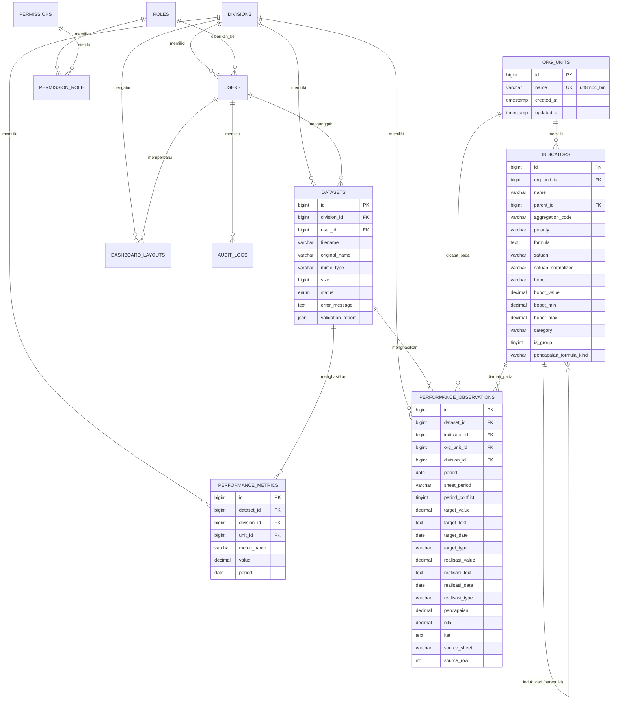
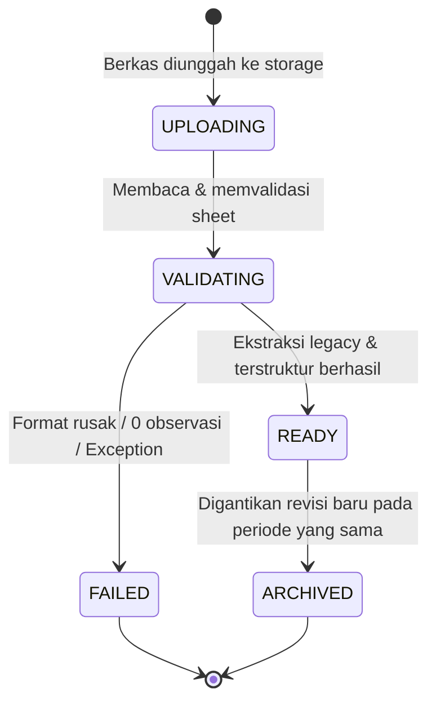

# 02 - Kamus Data & Relasi Tabel

Dokumen ini memuat kamus data teknis komprehensif dari 20 tabel basis data MySQL 8.4 pada sistem IBS / plnjbt-dashboard, perbandingan model terstruktur relasional versus model legacy flat, relasi antar-entitas, serta kontrak query "Latest Dataset Wins".

---

## 1. Ikhtisar Model Data: Dual-Write & Evolusi Skema

### 1.1 Mengapa Dua Model Data Hidup Berdampingan

Sistem IBS mengadopsi pendekatan koeksistensi model data (*dual-write*) selama masa transisi arsitektur:

1. **Model Legacy Flat (`performance_metrics`):**
   - Disusun sebagai tabel berformat flat satu dimensi: pasangan kunci-nilai numerik `(dataset_id, metric_name, value, period, division_id)`.
   - Format penamaan metrik digabung sebagai string teks tunggal (misalnya `"UPT SEMARANG | KINERJA OPERASI | target"` atau `"UPT SALATIGA | NILAI KINERJA ORGANISASI"`).
   - Berfungsi sebagai fondasi awal sistem dan jaring pengaman (*safety net*) instan. Apabila terjadi kendala tak terduga pada parsing model terstruktur, antarmuka dashboard legacy tetap dapat menampilkan data tanpa hambatan.

2. **Model Terstruktur Relasional (`org_units`, `indicators`, `performance_observations`):**
   - Dirancang melalui normalisasi data 3 lapis untuk merepresentasikan struktur sebenarnya dari workbook laporan kinerja PLN UIT JBT.
   - Memisahkan identitas unit kerja pelaksana (`org_units`), definisi master indikator kinerja beserta formula, polaritas, dan bobotnya (`indicators`), serta catatan transaksi periodik (`performance_observations`).
   - Menyimpan nilai secara berpresisi (*loss-aware*), memisahkan data numerik, teks, tanggal, capaian rasio mentah, serta skor nilai NKO tanpa pembulatan prematur.
   - Menjadi sumber kebenaran (*single source of truth*) untuk komponen visualisasi modern dan pembacaan KPI/NKO saat ini.

---

## 2. Diagram Relasi Entitas (ERD)

Berikut adalah diagram relasi entitas terintegrasi yang menghubungkan tabel-tabel utama di dalam sistem IBS:



---

## 3. Kamus Tabel Terstruktur

### 3.1 Tabel `org_units`
Menyimpan data master unit organisasi atau unit pelaksana teknis (UPT) di lingkungan PLN UIT JBT yang tercantum pada setiap sheet lembar kerja Excel.

- **Storage Engine:** InnoDB
- **Collation Default:** `utf8mb4_unicode_ci`

| Nama Kolom | Tipe Data | Nullable | Default | Collation / Keterangan |
|---|---|---|---|---|
| `id` | `bigint unsigned` | Tidak | AUTO_INCREMENT | Kunci primer (Primary Key). |
| `name` | `varchar(255)` | Tidak | - | Nama unit kerja verbatim dari judul sheet Excel. Menggunakan collation `utf8mb4_bin` (binary case-sensitive) untuk memastikan konsistensi penamaan tanpa salah deteksi spasi/kapitalisasi. |
| `created_at` | `timestamp` | Ya | NULL | Waktu pembuatan record. |
| `updated_at` | `timestamp` | Ya | NULL | Waktu pembaruan terakhir record. |

- **Indeks & Kunci:**
  - `PRIMARY KEY (id)`
  - `UNIQUE KEY org_units_name_unique (name)`

---

### 3.2 Tabel `indicators`
Menyimpan definisi master indikator kinerja, struktur hierarki pohon (parent-child), kategori, bobot, polaritas, dan aturan formula.

- **Storage Engine:** InnoDB
- **Collation Default:** `utf8mb4_unicode_ci`

| Nama Kolom | Tipe Data | Nullable | Default | Keterangan |
|---|---|---|---|---|
| `id` | `bigint unsigned` | Tidak | AUTO_INCREMENT | Kunci primer (Primary Key). |
| `org_unit_id` | `bigint unsigned` | Tidak | - | FK merujuk ke `org_units.id`. Restrict on delete. |
| `name` | `varchar(255)` | Tidak | - | Nama kanonis indikator kinerja. |
| `parent_id` | `bigint unsigned` | Ya | NULL | Self-referential FK merujuk ke `indicators.id`. Set null on delete. Menandai indikator induk hierarki. |
| `aggregation_code` | `varchar(255)` | Ya | NULL | Kode agregasi dari sheet Excel (misal: MAX, SUM, AVG). |
| `polarity` | `varchar(255)` | Ya | NULL | Arah polaritas indikator (`POS` untuk polaritas positif, `NEG` untuk polaritas negatif). |
| `formula` | `text` | Ya | NULL | Teks deskripsi rumus atau formula perhitungan. |
| `satuan` | `varchar(255)` | Ya | NULL | Satuan pengukuran mentah dari berkas sumber (contoh: %, Kali, Hari). |
| `satuan_normalized` | `varchar(255)` | Ya | NULL | Satuan hasil standarisasi korporat (disiapkan untuk fase evolusi lanjutan). |
| `bobot` | `varchar(255)` | Ya | NULL | Representasi teks bobot mentah dari sel (misal: "5%", "Max -3"). |
| `bobot_value` | `decimal(12,4)` | Ya | NULL | Nilai numerik bobot setelah normalisasi desimal. |
| `bobot_min` | `decimal(12,4)` | Ya | NULL | Batas bawah nilai bobot jika dinyatakan dalam rentang. |
| `bobot_max` | `decimal(12,4)` | Ya | NULL | Batas atas nilai bobot jika dinyatakan dalam rentang. |
| `category` | `varchar(255)` | Ya | NULL | Klasifikasi kategori indikator: `kpi` (indikator operasional) atau `nko` (agregat unit). |
| `is_group` | `tinyint(1)` | Tidak | 0 | Flag penanda apakah baris merupakan kelompok/kategori induk (1 = Ya, 0 = Tidak). |
| `pencapaian_formula_kind` | `varchar(255)` | Ya | NULL | Jenis deteksi formula capaian (contoh: RATIO_DIRECT, RATIO_INVERSE). |
| `created_at` | `timestamp` | Ya | NULL | Waktu pembuatan record. |
| `updated_at` | `timestamp` | Ya | NULL | Waktu pembaruan terakhir record. |

- **Indeks & Kunci:**
  - `PRIMARY KEY (id)`
  - `UNIQUE KEY indicators_org_unit_id_name_unique (org_unit_id, name)`
  - `KEY indicators_parent_id_foreign (parent_id)`
  - `CONSTRAINT indicators_org_unit_id_foreign FOREIGN KEY (org_unit_id) REFERENCES org_units (id) ON DELETE RESTRICT`
  - `CONSTRAINT indicators_parent_id_foreign FOREIGN KEY (parent_id) REFERENCES indicators (id) ON DELETE SET NULL`

---

### 3.3 Tabel `performance_observations`
Tabel fakta transaksi kinerja bulanan yang menyimpan nilai target, realisasi, capaian, dan skor NKO per indikator dan unit kerja.

- **Storage Engine:** InnoDB
- **Collation Default:** `utf8mb4_unicode_ci`

| Nama Kolom | Tipe Data | Nullable | Default | Keterangan |
|---|---|---|---|---|
| `id` | `bigint unsigned` | Tidak | AUTO_INCREMENT | Kunci primer (Primary Key). |
| `dataset_id` | `bigint unsigned` | Ya | NULL | FK merujuk ke `datasets.id`. Cascade on delete. |
| `indicator_id` | `bigint unsigned` | Tidak | - | FK merujuk ke `indicators.id`. Restrict on delete. |
| `org_unit_id` | `bigint unsigned` | Tidak | - | FK merujuk ke `org_units.id`. Restrict on delete. |
| `division_id` | `bigint unsigned` | Ya | NULL | FK merujuk ke `divisions.id`. Set null on delete. Menandai pemilik divisi data. |
| `period` | `date` | Tidak | - | Tanggal periode pelaporan efektif (format YYYY-MM-01). |
| `sheet_period` | `varchar(255)` | Ya | NULL | Teks judul banner periode mentah dari header sheet Excel. |
| `period_conflict` | `tinyint(1)` | Tidak | 0 | Flag deteksi inkonsistensi antara `sheet_period` dan `period` (1 = Konflik, 0 = Cocok/Tidak terdeteksi). |
| `target_value` | `decimal(18,4)` | Ya | NULL | Nilai numerik target kinerja. |
| `target_text` | `text` | Ya | NULL | Nilai target dalam bentuk teks jika non-numerik. |
| `target_date` | `date` | Ya | NULL | Nilai target berupa tanggal/tenggat waktu. |
| `target_type` | `varchar(255)` | Tidak | - | Tipe data target terdeteksi (`numeric`, `text`, `date`, `empty`). |
| `realisasi_value` | `decimal(18,4)` | Ya | NULL | Nilai numerik realisasi capaian kinerja. |
| `realisasi_text` | `text` | Ya | NULL | Nilai realisasi dalam bentuk teks jika non-numerik. |
| `realisasi_date` | `date` | Ya | NULL | Nilai realisasi berupa tanggal pemenuhan. |
| `realisasi_type` | `varchar(255)` | Tidak | - | Tipe data realisasi terdeteksi (`numeric`, `text`, `date`, `empty`). |
| `pencapaian` | `decimal(18,4)` | Ya | NULL | Nilai rasio pencapaian mentah dari workbook Excel. |
| `nilai` | `decimal(18,4)` | Ya | NULL | Nilai skor capaian NKO mentah dari sheet Excel. |
| `ket` | `text` | Ya | NULL | Teks keterangan atau catatan penjelasan baris dari Excel. |
| `source_sheet` | `varchar(255)` | Ya | NULL | Nama sheet Excel asal data. |
| `source_row` | `int unsigned` | Ya | NULL | Nomor baris fisik pada sheet Excel sumber (audit provenance). |
| `created_at` | `timestamp` | Ya | NULL | Waktu pembuatan record. |
| `updated_at` | `timestamp` | Ya | NULL | Waktu pembaruan terakhir record. |

- **Indeks & Kunci:**
  - `PRIMARY KEY (id)`
  - `UNIQUE KEY po_dataset_indicator_unit_period_unique (dataset_id, indicator_id, org_unit_id, period)`
  - `KEY performance_observations_indicator_id_foreign (indicator_id)`
  - `KEY performance_observations_org_unit_id_foreign (org_unit_id)`
  - `KEY performance_observations_division_id_foreign (division_id)`
  - `CONSTRAINT performance_observations_dataset_id_foreign FOREIGN KEY (dataset_id) REFERENCES datasets (id) ON DELETE CASCADE`
  - `CONSTRAINT performance_observations_indicator_id_foreign FOREIGN KEY (indicator_id) REFERENCES indicators (id) ON DELETE RESTRICT`
  - `CONSTRAINT performance_observations_org_unit_id_foreign FOREIGN KEY (org_unit_id) REFERENCES org_units (id) ON DELETE RESTRICT`
  - `CONSTRAINT performance_observations_division_id_foreign FOREIGN KEY (division_id) REFERENCES divisions (id) ON DELETE SET NULL`

---

## 4. Kamus Tabel Legacy & Dataset Lifecycle

### 4.1 Tabel `datasets`
Mencatat riwayat unggahan berkas spreadsheet, status lifecycle pemrosesan, dan ringkasan validasi.

- **Storage Engine:** InnoDB
- **Collation Default:** `utf8mb4_unicode_ci`

| Nama Kolom | Tipe Data | Nullable | Default | Keterangan |
|---|---|---|---|---|
| `id` | `bigint unsigned` | Tidak | AUTO_INCREMENT | Kunci primer (Primary Key). |
| `division_id` | `bigint unsigned` | Tidak | - | FK merujuk ke `divisions.id`. Cascade on delete. |
| `user_id` | `bigint unsigned` | Ya | NULL | FK merujuk ke `users.id` (pengunggah berkas). Set null on delete. |
| `filename` | `varchar(255)` | Tidak | - | Nama berkas acak yang tersimpan pada storage internal (`[hash].xlsx`). |
| `original_name` | `varchar(255)` | Tidak | - | Nama berkas asli saat diunggah (telah melalui proses sanitasi karakter). |
| `mime_type` | `varchar(255)` | Tidak | - | Tipe MIME berkas spreadsheet. |
| `size` | `bigint unsigned` | Tidak | - | Ukuran berkas dalam satuan byte. |
| `status` | `enum('UPLOADING', 'VALIDATING', 'READY', 'FAILED', 'ARCHIVED')` | Tidak | `'UPLOADING'` | Status siklus hidup dataset. |
| `error_message` | `text` | Ya | NULL | Deskripsi penyebab kegagalan jika dataset berstatus `FAILED`. |
| `validation_report` | `json` | Ya | NULL | Laporan komprehensif hasil validasi format dan baris (JSON). |
| `created_at` | `timestamp` | Ya | NULL | Waktu berkas diunggah. |
| `updated_at` | `timestamp` | Ya | NULL | Waktu pembaruan status terakhir. |

- **Indeks & Kunci:**
  - `PRIMARY KEY (id)`
  - `KEY datasets_division_status_index (division_id, status)`
  - `KEY datasets_created_at_index (created_at)`
  - `KEY datasets_user_id_foreign (user_id)`
  - `CONSTRAINT datasets_division_id_foreign FOREIGN KEY (division_id) REFERENCES divisions (id) ON DELETE CASCADE`
  - `CONSTRAINT datasets_user_id_foreign FOREIGN KEY (user_id) REFERENCES users (id) ON DELETE SET NULL`

#### Siklus Hidup Status Dataset (`Dataset Lifecycle`):

- **UPLOADING:** Berkas diterima oleh web server dan dialokasikan ke direktori penyimpanan lokal.
- **VALIDATING:** Berkas sedang diparsing, divalidasi struktur barisnya, dan diekstraksi ke tabel data.
- **READY:** Data berhasil disimpan lengkap pada tabel legacy maupun terstruktur. Dataset aktif dikonsumsi oleh dashboard.
- **FAILED:** Terjadi kesalahan parsing, kegagalan validasi, atau 0 observasi dihasilkan. Data legacy yang sempat tertulis dibersihkan secara otomatis.
- **ARCHIVED:** Dataset dinonaktifkan secara aman karena adanya dataset baru yang berstatus `READY` untuk divisi dan periode yang sama.

---

### 4.2 Tabel `performance_metrics`
Tabel metrik flat legacy yang memetakan metrik kinerja ke baris tunggal berpasangan nama dan nilai.

- **Storage Engine:** InnoDB
- **Collation Default:** `utf8mb4_unicode_ci`

| Nama Kolom | Tipe Data | Nullable | Default | Keterangan |
|---|---|---|---|---|
| `id` | `bigint unsigned` | Tidak | AUTO_INCREMENT | Kunci primer (Primary Key). |
| `metric_name` | `varchar(255)` | Tidak | - | Nama gabungan unit dan indikator (`UNIT | INDIKATOR`). |
| `value` | `decimal(15,2)` | Tidak | - | Nilai numerik metrik hasil parsing. |
| `period` | `date` | Tidak | - | Tanggal periode laporan metrik. |
| `unit_id` | `bigint unsigned` | Ya | NULL | FK merujuk ke `users.id`. Set null on delete (legacy mapping). |
| `division_id` | `bigint unsigned` | Ya | NULL | FK merujuk ke `divisions.id`. Set null on delete. |
| `dataset_id` | `bigint unsigned` | Ya | NULL | FK merujuk ke `datasets.id`. Cascade on delete. |
| `created_at` | `timestamp` | Ya | NULL | Waktu pembuatan record. |
| `updated_at` | `timestamp` | Ya | NULL | Waktu pembaruan terakhir record. |

- **Indeks & Kunci:**
  - `PRIMARY KEY (id)`
  - `KEY pm_dataset_id_index (dataset_id)`
  - `KEY pm_division_period_index (division_id, period)`
  - `KEY performance_metrics_unit_id_foreign (unit_id)`
  - `CONSTRAINT performance_metrics_dataset_id_foreign FOREIGN KEY (dataset_id) REFERENCES datasets (id) ON DELETE CASCADE`
  - `CONSTRAINT performance_metrics_division_id_foreign FOREIGN KEY (division_id) REFERENCES divisions (id) ON DELETE SET NULL`
  - `CONSTRAINT performance_metrics_unit_id_foreign FOREIGN KEY (unit_id) REFERENCES users (id) ON DELETE SET NULL`

---

## 5. Kamus Tabel Operasional, Konfigurasi, dan Keamanan

### 5.1 Tabel `dashboard_layouts`
Menyimpan konfigurasi tata letak widget dashboard yang dapat dikustomisasi per peran pengguna atau divisi kerja.

| Nama Kolom | Tipe Data | Nullable | Default | Keterangan |
|---|---|---|---|---|
| `id` | `bigint unsigned` | Tidak | AUTO_INCREMENT | Kunci primer. |
| `layout_key` | `varchar(255)` | Tidak | - | Kunci unik konfigurasi layout (misal: `admin_global`, `staff_divisi_3`). |
| `role_slug` | `varchar(255)` | Tidak | - | Slug peran pemilik layout (`admin`, `management`, `editor_dashboard`, `staff_divisi`). |
| `division_id` | `bigint unsigned` | Ya | NULL | FK merujuk ke `divisions.id`. Cascade on delete. |
| `widgets` | `json` | Tidak | - | Konfigurasi struktur kartu dan widget visual (JSON). |
| `updated_by` | `bigint unsigned` | Ya | NULL | FK merujuk ke `users.id` yang terakhir kali mengubah tata letak. Set null on delete. |
| `created_at` | `timestamp` | Ya | NULL | Waktu pembuatan record. |
| `updated_at` | `timestamp` | Ya | NULL | Waktu pembaruan terakhir record. |

- **Indeks & Kunci:**
  - `PRIMARY KEY (id)`
  - `UNIQUE KEY dashboard_layouts_layout_key_unique (layout_key)`
  - `KEY dashboard_layouts_division_id_foreign (division_id)`
  - `KEY dashboard_layouts_updated_by_foreign (updated_by)`
  - `KEY dashboard_layouts_role_slug_index (role_slug)`

---

### 5.2 Tabel `divisions`
Master divisi atau bidang di lingkungan PLN Unit Induk Transmisi Jawa Bagian Tengah (UIT JBT).

| Nama Kolom | Tipe Data | Nullable | Default | Keterangan |
|---|---|---|---|---|
| `id` | `bigint unsigned` | Tidak | AUTO_INCREMENT | Kunci primer. |
| `name` | `varchar(255)` | Tidak | - | Nama resmi divisi/bidang (Unique). |
| `slug` | `varchar(255)` | Tidak | - | Slug unik penanda divisi (misal: `perencanaan-pengusahaan`). |
| `description` | `text` | Ya | NULL | Deskripsi fungsi dan tanggung jawab divisi. |
| `created_at` | `timestamp` | Ya | NULL | Waktu pembuatan record. |
| `updated_at` | `timestamp` | Ya | NULL | Waktu pembaruan terakhir record. |

- **Indeks & Kunci:**
  - `PRIMARY KEY (id)`
  - `UNIQUE KEY divisions_name_unique (name)`
  - `UNIQUE KEY divisions_slug_unique (slug)`

---

### 5.3 Tabel `users`
Menyimpan identitas kredensial pengguna, peran RBAC, dan asosiasi divisi.

| Nama Kolom | Tipe Data | Nullable | Default | Keterangan |
|---|---|---|---|---|
| `id` | `bigint unsigned` | Tidak | AUTO_INCREMENT | Kunci primer. |
| `role_id` | `bigint unsigned` | Ya | NULL | FK merujuk ke `roles.id`. Set null on delete. |
| `division_id` | `bigint unsigned` | Ya | NULL | FK merujuk ke `divisions.id`. Set null on delete. Admin/Management bernilai NULL. |
| `name` | `varchar(255)` | Tidak | - | Nama lengkap pengguna. |
| `email` | `varchar(255)` | Tidak | - | Alamat email login resmi (Unique). |
| `email_verified_at`| `timestamp` | Ya | NULL | Timestamp verifikasi email. |
| `password` | `varchar(255)` | Tidak | - | Hash sandi Bcrypt. |
| `remember_token` | `varchar(100)` | Ya | NULL | Token Remember Me session. |
| `created_at` | `timestamp` | Ya | NULL | Waktu pembuatan akun. |
| `updated_at` | `timestamp` | Ya | NULL | Waktu pembaruan profil/sandi. |

- **Indeks & Kunci:**
  - `PRIMARY KEY (id)`
  - `UNIQUE KEY users_email_unique (email)`
  - `KEY users_role_id_foreign (role_id)`
  - `KEY users_division_id_foreign (division_id)`

---

### 5.4 Tabel `roles`, `permissions`, dan `permission_role`
Fondasi kontrol akses berbasis peran (*Role-Based Access Control* - RBAC) 4 tingkatan: `admin`, `management`, `editor_dashboard`, `staff_divisi`.

- **Tabel `roles`:**
  - Kolom: `id` (PK), `name` (varchar 255), `slug` (varchar 255 unique), `description` (varchar 255 nullable), `created_at`, `updated_at`.
- **Tabel `permissions`:**
  - Kolom: `id` (PK), `name` (varchar 255 unique, misal: `dataset.import`, `audit.view_all`), `description` (varchar 255 nullable), `created_at`, `updated_at`.
- **Tabel `permission_role`:**
  - Tabel pivot many-to-many.
  - Kolom: `permission_id` (FK ke `permissions.id` on delete cascade), `role_id` (FK ke `roles.id` on delete cascade).
  - Kunci: `PRIMARY KEY (permission_id, role_id)`.

---

### 5.5 Tabel `audit_logs`
Merekam jejak audit aktivitas sistem dan transaksi perubahan data. Dilindungi hak akses database *append-only* (hanya `SELECT` dan `INSERT` untuk user runtime `dashboard_app`).

| Nama Kolom | Tipe Data | Nullable | Default | Keterangan |
|---|---|---|---|---|
| `id` | `bigint unsigned` | Tidak | AUTO_INCREMENT | Kunci primer. |
| `user_id` | `bigint unsigned` | Ya | NULL | FK merujuk ke `users.id` pelaku aksi. Set null on delete. |
| `action` | `varchar(32)` | Tidak | - | Jenis aksi audit (contoh: `LOGIN`, `LOGOUT`, `IMPORT`, `CREATE`, `UPDATE`, `DELETE`). |
| `auditable_type` | `varchar(255)` | Ya | NULL | Nama kelas model Eloquent yang terdampak (Morph Type). NULL untuk aksi sesi/otentikasi. |
| `auditable_id` | `bigint unsigned` | Ya | NULL | ID record model yang terdampak (Morph ID). |
| `old_values` | `json` | Ya | NULL | Nilai atribut sebelum perubahan (JSON). |
| `new_values` | `json` | Ya | NULL | Nilai atribut setelah perubahan / payload ringkasan import (JSON). |
| `ip` | `varchar(45)` | Ya | NULL | Alamat IP klien (IPv4 / IPv6). |
| `user_agent` | `varchar(255)` | Ya | NULL | User Agent browser klien. |
| `created_at` | `timestamp` | Tidak | `CURRENT_TIMESTAMP` | Waktu mutlak pencatatan log. |

- **Indeks & Kunci:**
  - `PRIMARY KEY (id)`
  - `KEY audit_logs_auditable_type_auditable_id_index (auditable_type, auditable_id)`
  - `KEY audit_logs_action_index (action)`
  - `KEY audit_logs_created_at_index (created_at)`
  - `KEY audit_logs_user_created_index (user_id, created_at)`
  - `CONSTRAINT audit_logs_user_id_foreign FOREIGN KEY (user_id) REFERENCES users (id) ON DELETE SET NULL`

---

### 5.6 Tabel Framework Laravel (8 Tabel Infrastruktur)
Sistem memuat 8 tabel infrastruktur standar yang dikelola langsung oleh framework Laravel:

1. **`cache`:** Penyimpanan key-value cache database (`key`, `value`, `expiration`).
2. **`cache_locks`:** Mekanisme atomis distributed lock untuk mencegah race-condition proses paralel (`key`, `owner`, `expiration`).
3. **`failed_jobs`:** Pencatatan antrean pekerjaan background yang gagal diproses (`uuid`, `connection`, `queue`, `payload`, `exception`, `failed_at`).
4. **`job_batches`:** Pelacakan eksekusi batch antrean pekerjaan (`id`, `name`, `total_jobs`, `pending_jobs`, `failed_jobs`, dsb).
5. **`jobs`:** Antrean pekerjaan aktif (*active queue jobs*) yang menunggu diproses pekerja antrean (`queue`, `payload`, `attempts`, `reserved_at`, `available_at`).
6. **`migrations`:** Buku besar riwayat migrasi skema database (`id`, `migration`, `batch`).
7. **`password_reset_tokens`:** Penyimpanan token sementara pemulihan kata sandi (`email`, `token`, `created_at`).
8. **`sessions`:** Sesi pengguna terautentikasi (`id`, `user_id`, `ip_address`, `user_agent`, `payload`, `last_activity`).

---

### 5.7 Ringkasan Matriks 20 Tabel Basis Data
Tepat 20 tabel terdaftar pada basis data `dashboard` sebagaimana dikonfirmasi pada file konfigurasi hak akses `docker/mysql/harden-audit-log.sql` dan verifikasi perintah `SHOW TABLES`:

| No | Nama Tabel | Kelompok Modul | Fungsi Utama | Status Hak Akses `dashboard_app` |
|---|---|---|---|---|
| 1 | `org_units` | Terstruktur | Master unit kerja / UPT | SELECT, INSERT, UPDATE, DELETE |
| 2 | `indicators` | Terstruktur | Master indikator, hierarki, dan formula | SELECT, INSERT, UPDATE, DELETE |
| 3 | `performance_observations` | Terstruktur | Data transaksi nilai capaian kinerja | SELECT, INSERT, UPDATE, DELETE |
| 4 | `datasets` | Legacy & Lifecycle | Riwayat upload dan status siklus hidup | SELECT, INSERT, UPDATE, DELETE |
| 5 | `performance_metrics` | Legacy | Metrik flat legacy jaring pengaman | SELECT, INSERT, UPDATE, DELETE |
| 6 | `dashboard_layouts` | Konfigurasi | Pengaturan tata letak kartu visual | SELECT, INSERT, UPDATE, DELETE |
| 7 | `divisions` | Keamanan & RBAC | Master bidang / divisi | SELECT, INSERT, UPDATE, DELETE |
| 8 | `users` | Keamanan & RBAC | Master pengguna sistem | SELECT, INSERT, UPDATE, DELETE |
| 9 | `roles` | Keamanan & RBAC | Definisi peran RBAC | SELECT, INSERT, UPDATE, DELETE |
| 10 | `permissions` | Keamanan & RBAC | Hak akses fitur aplikasi | SELECT, INSERT, UPDATE, DELETE |
| 11 | `permission_role` | Keamanan & RBAC | Pivot mapping peran dan izin | SELECT, INSERT, UPDATE, DELETE |
| 12 | `audit_logs` | Keamanan & Audit | Rekam jejak audit (Append-Only) | **SELECT, INSERT (Tanpa UPDATE/DELETE)** |
| 13 | `cache` | Framework | Cache driver database | SELECT, INSERT, UPDATE, DELETE |
| 14 | `cache_locks` | Framework | Mekanisme lock atomic cache | SELECT, INSERT, UPDATE, DELETE |
| 15 | `failed_jobs` | Framework | Log antrean background yang gagal | SELECT, INSERT, UPDATE, DELETE |
| 16 | `job_batches` | Framework | Manajemen batch queue | SELECT, INSERT, UPDATE, DELETE |
| 17 | `jobs` | Framework | Antrean aktif queue Laravel | SELECT, INSERT, UPDATE, DELETE |
| 18 | `migrations` | Framework | Catatan histori migrasi skema | SELECT, INSERT, UPDATE, DELETE |
| 19 | `password_reset_tokens` | Framework | Token reset sandi akun | SELECT, INSERT, UPDATE, DELETE |
| 20 | `sessions` | Framework | Penyimpanan sesi web terotentikasi | SELECT, INSERT, UPDATE, DELETE |

---

## 6. Kontrak Query "Latest Dataset Wins"

### 6.1 Latar Belakang & Prinsip Kontrak
Dalam siklus operasional, satu periode pelaporan (misalnya periode `2026-08-01`) dapat memiliki beberapa rekaman dataset:
- Dataset yang diarsipkan secara historis (`status = 'ARCHIVED'`).
- Dataset yang gagal saat proses impor (`status = 'FAILED'`).
- Dataset aktif terbaru hasil revisi (`status = 'READY'`).

Untuk menjamin bahwa pembacaan data kinerja pada kartu eksekutif, grafik tren, maupun tabel evaluasi NKO selalu menyajikan data paling mutakhir dan tidak menduplikasi nilai, sistem menetapkan kontrak query: **"Latest Dataset Wins"**.

Kontrak ini diimplementasikan pada method `StructuredNkoReader::latestDatasetIds(?string $divisionId, string $period)`:

```php
public function latestDatasetIds(?string $divisionId, string $period): array
{
    return DB::table('performance_observations as po')
        ->join('datasets as d', 'd.id', '=', 'po.dataset_id')
        ->where('d.status', Dataset::STATUS_READY)
        ->where('po.period', $period)
        ->when($divisionId !== null, fn ($q) => $q->where('po.division_id', $divisionId))
        ->whereNotExists(function ($q) use ($period, $divisionId) {
            $q->select(DB::raw(1))
                ->from('performance_observations as newer')
                ->join('datasets as nd', 'nd.id', '=', 'newer.dataset_id')
                ->where('nd.status', Dataset::STATUS_READY)
                ->where('newer.period', $period)
                ->where(function ($sameScope) {
                    $sameScope->whereColumn('newer.division_id', 'po.division_id')
                        ->orWhere(function ($bothNull) {
                            $bothNull->whereNull('newer.division_id')
                                ->whereNull('po.division_id');
                        });
                })
                ->when($divisionId !== null, fn ($sub) => $sub->where('newer.division_id', $divisionId))
                ->where(function ($better) {
                    $better->whereColumn('nd.created_at', '>', 'd.created_at')
                        ->orWhere(function ($tie) {
                            $tie->whereColumn('nd.created_at', '=', 'd.created_at')
                                ->whereColumn('nd.id', '>', 'd.id');
                        });
                });
        })
        ->distinct()
        ->pluck('d.id')
        ->map(fn ($id): int => (int) $id)
        ->all();
}
```

### 6.2 Mengapa Subquery Berkorelasi `NOT EXISTS`?

Pemilihan arsitektur subquery berkorelasi `NOT EXISTS` memiliki alasan teknis yang kuat dibandingkan alternatif SQL lainnya:

1. **Kompatibilitas Lintas Mesin Basis Data (MySQL 8.4 & SQLite):**
   - Sistem diuji menggunakan automated test suite pada database SQLite in-memory dan berjalan di lingkungan produksi pada MySQL 8.4.
   - Operator kesetaraan NULL-safe bawaan MySQL (`<=>`) tidak didukung oleh SQLite. Pendekatan `whereColumn(...)->orWhere(function ($bothNull) { ... })` menjamin kompatibilitas 100% di kedua platform tanpa sintaks khusus non-standar.

2. **Penanganan Scope Divisi NULL yang Benar:**
   - Dalam SQL standar, evaluasi `newer.division_id = po.division_id` akan menghasilkan nilai `UNKNOWN` apabila salah satu sisi bernilai `NULL`. Akibatnya, dataset global yang tidak memiliki afiliasi divisi (`division_id = NULL`) tidak akan pernah dianggap tersupersede oleh perbandingan kolom biasa.
   - Pola ekspresi eksplisit yang diterapkan memastikan bahwa scope `NULL` diperlakukan sebagai satu partisi kesetaraan yang utuh.

3. **Deterministik Tie-Breaker:**
   - Jika dua dataset diunggah pada detik mikro yang sama (`nd.created_at = d.created_at`), sistem menerapkan pemecah seri (*tie-breaker*) berbasis ID unik numerik (`nd.id > d.id`). Hal ini menjamin hanya ada satu dataset pemenang absolut tanpa ambiguitas urutan.

4. **Kelemahan Window Function Tereliminasi:**
   - Alternatif menggunakan window function (`ROW_NUMBER() OVER (PARTITION BY division_id, period ORDER BY created_at DESC)`) rentan terhadap perilaku pengelompokan baris bernilai `NULL` pada berbagai versi basis data dan sering kali memerlukan subquery bertingkat yang lebih berat saat digabungkan dengan pagination. Correlated `NOT EXISTS` memanfaatkan indeks komposit `(division_id, status)` dan `(created_at)` yang menghasilkan eksekusi query optimal.

---
