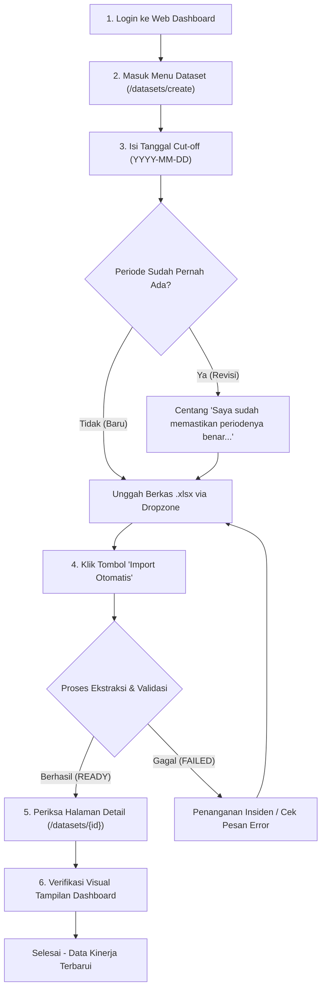

# 04 - SOP Operasional Impor Bulanan & Penanganan Insiden (Troubleshooting Runbook)

Dokumen ini merupakan Standar Operasional Prosedur (SOP) resmi dan panduan pemecahan masalah (*troubleshooting runbook*) untuk pembaruan data bulanan Key Performance Indicator (KPI) pada sistem IBS / plnjbt-dashboard PLN Unit Induk Transmisi Jawa Bagian Tengah (UIT JBT).

Dokumen ini dirancang khusus bagi Person in Charge (PIC) Bidang Perencanaan Pengusahaan (Staf Divisi) serta Administrator Sistem yang bertanggung jawab atas keteraturan, keandalan, dan integritas data kinerja bulanan organisasi.

---

## 1. Pendahuluan & Ketentuan Umum

### 1.1 Tujuan SOP

Tujuan penyusunan SOP ini adalah:
1. Memberikan panduan kerja baku langkah-demi-langkah bagi operator PIC dalam mengunggah berkas laporan kinerja bulanan resmi tanpa memerlukan bantuan teknis pemrograman atau intervensi langsung ke basis data.
2. Menjelaskan mekanisme otomatisasi sistem dalam membaca lembar kerja multi-unit, memetakan indikator, dan memvalidasi keabsahan data numerik.
3. Memberikan panduan penanganan mandiri terhadap peringatan sistem, khususnya bendera perbedaan periode (*period conflict*).
4. Menyediakan prosedur mitigasi dan langkah penanganan insiden ketika berkas gagal diproses (*status FAILED*), dengan tetap menjamin keberlanjutan layanan dashboard eksekutif (*zero-downtime resilience*).

### 1.2 Sasaran Pengguna (Target Audience)

- **PIC Bidang Perencanaan Pengusahaan (Staf Divisi):** Pelaksana utama yang memiliki wewenang operasional untuk mengunggah berkas realisasi kinerja bulanan PLN UIT JBT.
- **Administrator Sistem & Tim IT PLN UIT JBT:** Pengelola sistem yang bertindak sebagai eskalasi lapis kedua apabila terjadi kendala infrastruktur atau anomali sistemik yang tidak dapat diselesaikan pada level berkas spreadsheet.
- **Manajemen & Evaluator Kinerja:** Pemantau hasil visualisasi dashboard untuk memastikan keabsahan data laporan berkala.

### 1.3 Siklus Operasional Bulanan

Pemutakhiran data kinerja dilaksanakan secara periodik satu kali setiap bulan dengan jadwal operasional standar:
- **Periode Pelaksanaan:** Tanggal 5 hingga tanggal 10 setiap bulan baru (setelah lembar rekapitulasi kinerja resmi PLN ditandatangani dan dibekukan oleh komite/manajemen).
- **Periode Data (Cut-off Date):** Hari kalender terakhir dari bulan yang dilaporkan (contoh: untuk laporan kinerja bulan Agustus 2026, tanggal cut-off yang wajib digunakan adalah `2026-08-31`).

### 1.4 Kebijakan Akses & Scoping Divisi (Role-Based Access Control)

Sistem menerapkan pembatasan hak akses berbasis peran (RBAC) secara ketat pada backend:
1. **Hak Akses Unggah KPI:** Hanya pengguna dengan peran **Admin** atau **Staf Divisi** yang terdaftar di bawah divisi **Perencanaan Pengusahaan** (`division_id` sesuai) yang diizinkan mengakses dan menjalankan proses impor KPI otomatis.
2. **Pencegahan Akses Lintas Divisi:** Pengguna tanpa divisi atau staf divisi lain yang mencoba mengakses fungsi ini akan secara otomatis ditolak dengan pesan kesalahan HTTP 403 Forbidden (*"Import laporan KPI hanya untuk admin atau staf divisi Perencanaan Pengusahaan"*).
3. **Audit Trail:** Seluruh aksi pengunggahan, pemrosesan berkas, dan pengarsipan dataset otomatis tercatat secara permanen di dalam tabel `audit_logs`.

---

## 2. Prasyarat Berkas Laporan Kinerja Bulanan

Sebelum memulai proses pengunggahan di aplikasi, PIC wajib memastikan berkas laporan kinerja memenuhi spesifikasi teknis dan struktural berikut:

### 2.1 Format dan Ekstensi Berkas

- Berkas harus berformat lembar kerja Microsoft Excel OpenXML dengan ekstensi `.xlsx`.
- Berkas dengan ekstensi biner lama (`.xls`), biner terkompresi (`.xlsb`), berkas terenkripsi dengan proteksi kata sandi (*password protected*), atau berkas teks (`.csv`) **TIDAK DIDUKUNG** pada modul Impor KPI Otomatis.
- Ukuran maksimal berkas yang diizinkan oleh sistem adalah **5120 KB (5 MB)** sesuai konfigurasi pada `config/dataset_import.php`.

### 2.2 Konvensi Penamaan Berkas

Gunakan konvensi penamaan berkas resmi korporat untuk mempermudah penelusuran audit fisik, contoh:
- `08. Realisasi Kinerja Agustus 2026.xlsx`
- `Realisasi Kinerja Semester I 2026.xlsx`
- Hindari penggunaan simbol karakter aneh atau nama file sementara seperti `Copy of draft_final_rev2.xlsx`.

### 2.3 Standar Struktur Lembar Kerja (Workbook Structure)

Modul konverter sistem (`App\Services\KpiReportConverter` dan `App\Services\StructuredKpiImporter`) membaca berkas dengan asumsi struktur berikut:

1. **Sheet Multi-Unit Kerja:**
   - Workbook memuat satu atau lebih lembar kerja (sheet) yang merepresentasikan unit organisasi PLN.
   - Contoh sheet standar: `TJBT` (Kantor Induk), `TJBB`, `TJBTB`, `UPT Semarang`, `UPT Salatiga`, `UPT Purwokerto`, `UPT Cirebon`, `UPT Bandung`, dll.
   - Setiap sheet unit akan diekstraksi dan digabungkan menjadi satu kesatuan dataset konsolidasi di bawah naungan divisi Perencanaan Pengusahaan.
2. **Posisi Baris Header Tabel:**
   - Header tabel utama indikator kinerja wajib berada pada rentang **baris 4 hingga baris 6**.
   - Kolom-kolom standar yang wajib ada:
     * `NO` (Nomor urut indikator)
     * `INDIKATOR KINERJA` / `INDIKATOR` (Nama indikator KPI)
     * `SATUAN` (Satuan pengukuran, misal %, Hari, Kali, MVA)
     * `BOBOT` (Bobot evaluasi)
     * `TARGET` (Angka sasaran kinerja)
     * `REALISASI` (Angka realisasi pencapaian)
     * `PENCAPAIAN` (Persentase atau rasio capaian)
     * `NILAI` (Skor terbobot akhir)
3. **Banner Periode:**
   - Teks judul laporan pada bagian atas sheet (biasanya baris 2 atau 3), memuat keterangan periode seperti `"REALISASI KINERJA S.D. AGUSTUS 2026"`.

### 2.4 Lembar Periksa Mandiri (Pre-Flight Checklist PIC)

Lakukan pemeriksaan cepat berikut pada Microsoft Excel sebelum mengunggah:
- [ ] Berkas dapat dibuka secara normal tanpa peringatan *"Excel found unreadable content"*.
- [ ] Tidak ada baris kosong baru yang disisipkan di atas baris header (baris 1 s.d. 3).
- [ ] Sheet tidak diproteksi oleh kata sandi lembar kerja (*sheet protection password*).
- [ ] Kolom realisasi dan pencapaian tidak menampilkan pesan galat formula seperti `#REF!`, `#DIV/0!`, atau `#VALUE!`.
- [ ] Ukuran berkas tidak melebihi batas 5 MB.

---

## 3. Prosedur Operasional Langkah-demi-Langkah (Step-by-Step SOP)

Berikut adalah panduan teknis operasional 1-klik untuk pemutakhiran dataset bulanan:



### Langkah 1: Login ke Aplikasi Dashboard

1. Buka peramban web modern (Google Chrome, Microsoft Edge, atau Mozilla Firefox).
2. Masukkan alamat URL sistem:
   - Lingkungan Pengembangan/Lokal: `http://localhost:8000`
   - Lingkungan Server Internal PLN: `http://<ip-atau-domain-server-dashboard>`
3. Masukkan kredensial akun Anda:
   - Alamat Email / Username terdaftar.
   - Kata Sandi.
4. Klik tombol **Masuk**.
5. Pastikan akun yang digunakan memiliki peran **Staf Divisi Perencanaan Pengusahaan** atau **Admin**.

### Langkah 2: Navigasi ke Halaman Impor KPI Otomatis

1. Perhatikan bilah navigasi samping (Sidebar) di sebelah kiri layar.
2. Klik menu **Dataset** untuk membuka daftar dataset yang tersedia.
3. Klik tombol **Tambah Dataset** di pojok kanan atas, atau langsung akses rute `/datasets/create`.
4. Gulir layar ke bawah menuju kartu formulir bertajuk:
   **"Import Laporan KPI dari Mentor (Otomatis)"**.
   *(Catatan: Kartu ini memanfaatkan endpoint rute `POST /datasets/kpi-import`)*.

### Langkah 3: Pengisian Formulir & Pemilihan Berkas

1. **Menentukan Tanggal Cut-off Periode Data (`period`):**
   - Pada kolom input **Periode data**, gunakan pemilih tanggal (*date picker*) atau ketikkan tanggal dalam format `YYYY-MM-DD`.
   - **Aturan Wajib:** Tanggal yang dipilih **HARUS** merupakan tanggal hari terakhir pada bulan laporan.
     * Kinerja Januari 2026: `2026-01-31`
     * Kinerja Februari 2026: `2026-02-28` (atau `2026-02-29` pada tahun kabisat)
     * Kinerja Agustus 2026: `2026-08-31`
     * Kinerja Desember 2026: `2026-12-31`
2. **Pemeriksaan Daftar Periode Riwayat & Konfirmasi Revisi (`confirm_archive`):**
   - Perhatikan kotak informasi di bawah kolom input tanggal. Sistem menampilkan daftar periode yang telah tersimpan di dalam basis data:
     `Periode yang sudah pernah diimpor: 2026-01-31, 2026-02-28, ...`
   - **Jika Anda Mengunggah Periode Baru:** Kotak centang konfirmasi tidak wajib dicentang.
   - **Jika Anda Melakukan Revisi (Mengunggah Ulang Periode yang Sama):**
     * Sistem menerapkan pengaman salah ketik (*pre-flight safeguard*).
     * Anda **WAJIB** mencentang kotak:
       *"Saya sudah memastikan periodenya benar, dan memahami bahwa import ini merevisi periode tersebut."*
     * Hal ini bertujuan untuk mengonfirmasi bahwa Anda sadar dataset versi lama untuk periode tersebut akan diarsipkan secara otomatis oleh sistem.
3. **Memilih Berkas Laporan Kinerja (`file`):**
   - Seret (*drag-and-drop*) berkas Excel `.xlsx` dari Windows Explorer ke dalam kotak area unggah (*dropzone*).
   - Atau klik area dropzone, cari berkas pada komputer Anda, lalu klik **Open**.
   - Pastikan nama berkas terpilih sudah muncul pada kotak dropzone.

### Langkah 4: Eksekusi Impor 1-Klik & Pemrosesan Sistem

1. Klik tombol **Import Otomatis** (berwarna abu-abu gelap/hitam di sudut kiri bawah kartu formulir).
2. Sistem akan memproses berkas secara otomatis di latar belakang:
   - Membuka dan mengekstrak data dari seluruh sheet unit kerja (`KpiReportConverter`).
   - Melakukan validasi struktur tabel dan konsistensi tipe data (`DatasetImportService`).
   - Menyimpan metrik agregat ke tabel `performance_metrics` dan rincian observasi atomik ke tabel terstruktur `performance_observations` (`StructuredKpiImporter`).
   - Melakukan normalisasi skala skor (skala rasio vs skala persen) menggunakan `KpiScoreNormalizer`.
   - Jika proses selesai dan sukses, dataset lama untuk periode bersangkutan secara otomatis dialihkan statusnya menjadi `ARCHIVED`.
3. Tunggu beberapa detik hingga sistem menyelesaikan proses dan memunculkan notifikasi hasil impor.

### Langkah 5: Verifikasi Hasil pada Halaman Detail Dataset

Setelah proses impor selesai, sistem akan menampilkan notifikasi hijau berisi ringkasan data yang diimpor, contoh:
```text
Berhasil mengimpor 1 dataset.
Perencanaan Pengusahaan: 852 baris (+48 indikator, 852 observasi terstruktur)

Dataset periode 2026-08-31 sebelumnya diarsipkan otomatis (1 dataset) agar data tidak berlipat.
```

Untuk memverifikasi dataset secara menyeluruh:
1. Klik menu **Dataset** lalu pilih baris dataset teratas yang baru saja terbentuk, atau akses URL detail `/datasets/{id}`.
2. Periksa parameter utama pada halaman detail:
   - **Badge Status:** Pastikan berstatus hijau **`READY`**.
   - **Nama Berkas & Ukuran:** Sesuai dengan berkas yang Anda unggah.
   - **Kotak Ringkasan Validasi:**
     * `OK`: Menampilkan jumlah baris data yang berhasil diproses secara sempurna (misal: 852).
     * `WARNING`: Menampilkan jumlah baris dengan peringatan non-kritis (misal nilai outlier numerik).
     * `FATAL`: Wajib bernilai 0 untuk dataset yang berhasil aktif.
     * `KONFLIK PERIODE`: Menampilkan jumlah observasi yang memiliki perbedaan banner sheet (jika ada, lihat rincian pada Bagian 4).
3. Anda dapat mengklik tombol **Export Excel** pada halaman ini jika ingin mengunduh salinan data normalisasi yang tersimpan dalam sistem.

### Langkah 6: Validasi Tampilan Visual Dashboard Eksekutif

1. Klik menu **Dashboard** pada bilah navigasi utama untuk kembali ke halaman beranda.
2. Pastikan filter waktu menampilkan periode yang baru saja diimpor:
   - **Kartu Ringkasan Kinerja (NKO):** Periksa apakah nilai Nilai Kinerja Organisasi (NKO) UIT JBT telah terbarui sesuai dengan lembar rekapitulasi Excel resmi.
   - **Peringkat Kinerja Unit (Leaderboard):** Pastikan daftar peringkat unit (UPT Semarang, UPT Salatiga, UPT Purwokerto, dll.) menyajikan skor NKO bulan berjalan secara lengkap dan urut.
   - **Grafik Tren Kinerja:** Pastikan titik data bulan berjalan bertambah pada grafik garis tren tanpa mengalami pemutusan tren.

---

## 4. Penanganan Khusus: Bendera `period_conflict`

### 4.1 Definisi dan Latar Belakang Masalah

Pada operasional lapangan di PLN, berkas laporan kinerja bulanan sering kali disusun dengan cara menyalin (*copy-paste*) berkas lembar kerja bulan sebelumnya. Sering kali penyusun berkas memperbarui seluruh isi tabel indikator, realisasi, dan pencapaian, namun **lupa memperbarui teks banner judul** pada bagian atas lembar kerja.

Contoh kasus riil:
- Berkas yang diunggah: Laporan Kinerja Agustus 2026.
- Input Tanggal Cut-off oleh PIC pada formulir: `2026-08-31` (merepresentasikan periode `2026-08`).
- Teks Banner pada sheet Excel: Tertulis `"REALISASI KINERJA S.D. FEBRUARI 2025"` (merepresentasikan periode `2025-02`).

Ketika sistem membaca lembar kerja tersebut, `StructuredKpiImporter` mendeteksi ketidaksesuaian leksikal antara banner sheet dan tanggal cut-off input form. Dalam kondisi ini, sistem mengaktifkan bendera **`period_conflict = 1` (true)** pada baris observasi terkait.

### 4.2 Kebijakan Sistem: Keputusan Bisnis 6 Pak Gama (2026-10-25)

Sesuai arahan dan kesepakatan resmi dengan mentor (Keputusan Bisnis 6 Pak Gama):
1. **Tanggal Cut-off Form Adalah Sumber Kebenaran Mutlak (*Canonical Truth*):** Tanggal periode yang dipilih secara sadar oleh PIC melalui formulir web diakui sebagai periode efektif yang sah bagi seluruh observasi.
2. **Impor TIDAK DIBATALKAN:** Sistem **TIDAK MENGGAGALKAN** proses impor dan tidak menghentikan penulisan data ke basis data.
3. **Pencatatan Informatif:** Sistem mencatat perbedaan tersebut ke dalam kolom `period_conflict` pada tabel `performance_observations` serta merangkumnya pada kolom JSON `validation_report` di tabel `datasets`.

### 4.3 Tampilan pada Antarmuka Detail Dataset

Apabila berkas yang Anda unggah mengandung perbedaan banner sheet, pada halaman detail dataset (`/datasets/{id}`) akan muncul tampilan visual berikut:

1. **Badge Kuning/Oranye pada Ringkasan Validasi:**
   `KONFLIK PERIODE: X` (di mana X adalah jumlah observasi terdampak).
2. **Kotak Peringatan Informatif:**
   ```text
   Konflik periode banner sheet (X observasi)
   Periode banner sheet berbeda dari periode upload efektif. Data tetap disimpan menggunakan periode upload (banner sheet: YYYY-MM).
   ```

### 4.4 Panduan Tindakan bagi PIC

Apabila Anda melihat indikator `KONFLIK PERIODE` pada dataset yang baru saja diimpor:

1. **Lakukan Verifikasi Visual Berkas Asli:**
   - Buka kembali berkas Excel di komputer Anda.
   - Pastikan bahwa data angka di dalam tabel memang benar merupakan data bulan berjalan (misal: Agustus 2026), bukan berkas lama yang salah pilih.
2. **Jika Berkas Sudah Benar:**
   - **TIDAK DIPERLUKAN TINDAKAN APAPUN.**
   - Anda **TIDAK PERLU** menghubungi tim pengembang atau DBA untuk mengubah data di database.
   - Sistem telah secara otomatis menyimpan seluruh metrik dan observasi menggunakan tanggal cut-off yang Anda inputkan (`2026-08-31`). Dashboard akan langsung menampilkan data tersebut dengan benar.
3. **Tindakan Pencegahan Administratif:**
   - Berikan catatan kepada staf penyusun berkas Excel di unit kerja agar di bulan-bulan berikutnya lebih teliti memperbarui teks banner judul sebelum berkas didistribusikan.

---

## 5. Panduan Penanganan Insiden & Mitigasi Error (Troubleshooting Runbook)

Bagian ini memuat panduan diagnostik mandiri apabila proses impor mengalami kegagalan, muncul notifikasi merah, atau menghasilkan dataset berstatus `FAILED`.

### 5.1 Matriks Diagnostik Cepat (Quick Diagnostic Table)

| Gejala / Pesan Kesalahan | Kemungkinan Penyebab | Tindakan Mitigasi PIC |
|---|---|---|
| *"Periode YYYY-MM-DD sudah pernah diimpor. Mengimpor periode yang sama akan mengarsipkan dataset lama..."* | Mengunggah ulang periode yang sudah ada tanpa mencentang persetujuan revisi. | Centang kotak konfirmasi *"Saya sudah memastikan periodenya benar..."* lalu klik kembali Import Otomatis. |
| *"File tidak dapat dibaca. Pastikan file Excel tidak rusak."* | Berkas korup, rusak saat transfer, atau format berkas bukan OpenXML standar. | Buka berkas di Excel, lakukan **Save As** dengan format `.xlsx`, lalu unggah ulang. |
| *"[Unit]: layout sheet tidak dikenali — periksa file."* | Baris header bergeser, ada baris kosong baru di baris 1-3, atau nama kolom diubah. | Pastikan header tabel berada pada baris 4-6 dengan nama kolom standar template PLN. |
| *"[Unit]: tidak ada baris data yang bisa dibaca."* | Sheet unit kosong atau seluruh baris indikator tidak memiliki data numerik. | Periksa isi sheet unit yang disebutkan pada pesan galat, pastikan tabel indikator terisi. |
| *"File tidak boleh lebih besar dari 5120 kilobyte."* | Ukuran berkas melebihi batas sistem (5 MB). | Hapus sheet dokumentasi foto, grafik berat, atau style sel yang tidak relevan di Excel. |
| Dataset berstatus `FAILED`: *"Penulisan tabel terstruktur gagal..."* | Struktur tabel indikator mengalami kerusakan parah atau formula Excel rusak total. | Periksa formula lembar kerja, hilangkan error `#REF!`, dan unggah kembali. |
| Angka NKO pada Dashboard tampak kosong pasca-impor | Filter bulan dashboard belum disesuaikan atau browser menyimpan cache lama. | Muat ulang peramban (*hard refresh* Ctrl+F5) dan pastikan memilih periode cut-off yang sesuai. |

---

### 5.2 Skenario 1: Berkas Korup atau Format Lembar Kerja Salah

#### A. Gejala
- Sistem memunculkan kotak pesan berwarna merah setelah tombol diklik:
  `"File tidak dapat dibaca. Pastikan file Excel tidak rusak."`
- Atau validasi formulir menolak berkas dengan pesan:
  `"The file must be a file of type: xlsx."`

#### B. Akar Penyebab
1. Berkas mengalami kerusakan byte (*corrupted binary*) saat diunduh dari email atau media penyimpanan awan.
2. Berkas berformat biner Excel lama (`.xls` versi 97-2003), berkas Excel biner makro (`.xlsb` atau `.xlsm`), atau berkas teks koma (`.csv`) yang diganti namanya secara manual menjadi `.xlsx`.
3. Berkas masih terbuka (*file locked*) oleh aplikasi lain dengan hak akses eksklusif saat diunggah.

#### C. Prosedur Pemulihan (Solusi PIC)
1. Buka berkas tersebut pada aplikasi Microsoft Excel resmi di komputer Anda.
2. Jika Excel menampilkan kotak dialog perbaikan berkas (*"Excel found unreadable content. Do you want to recover...?"*), klik **Yes / Recover**.
3. Klik menu **File** -> **Save As** (Simpan Sebagai).
4. Pada menu pilihan tipe berkas (*Save as type*), pastikan memilih:
   **Excel Workbook (*.xlsx)** (BUKAN Excel 97-2003, BUKAN Excel Binary, BUKAN CSV).
5. Beri nama berkas baru (contoh: `Realisasi Kinerja Agustus 2026_Fixed.xlsx`).
6. Tutup aplikasi Excel untuk memastikan berkas tidak dalam status terkunci.
7. Unggah kembali berkas hasil perbaikan tersebut melalui formulir web dashboard.

---

### 5.3 Skenario 2: Header Kolom Sheet Bergeser atau Struktur Berubah

#### A. Gejala
- Muncul notifikasi merah dengan daftar rincian unit yang gagal:
  ```text
  Unit gagal diproses:
  - UPT Semarang: layout sheet tidak dikenali — periksa file.
  - TJBT: layout sheet tidak dikenali — periksa file.
  ```

#### B. Akar Penyebab
Sistem konverter (`KpiReportConverter`) secara terprogram mencari baris header pada **baris 4 hingga baris 6** untuk menemukan penanda kolom utama (`INDIKATOR`, `TARGET`, `REALISASI`, `PENCAPAIAN`).
Kegagalan terjadi jika:
1. Operator menyisipkan baris keterangan kosong baru di atas tabel (misal menyisipkan 3 baris kosong sehingga header bergeser ke baris 8).
2. Teks header diubah secara sepihak (contoh: kata `"INDIKATOR KINERJA"` diganti menjadi `"ITEM KPI"`).
3. Penggabungan sel (*merge cells*) vertikal yang tidak standar sehingga teks header tidak terbaca pada baris pembacaan sistem.

#### C. Prosedur Pemulihan (Solusi PIC)
1. Buka berkas Excel dan klik lembar kerja unit yang disebutkan pada pesan galat (misal: sheet `UPT Semarang`).
2. Periksa posisi baris header:
   - Baris 1: Keterangan umum korporat (opsional).
   - Baris 2 s.d. 3: Judul banner laporan (misal `"REALISASI KINERJA S.D. AGUSTUS 2026"`).
   - Baris 4 s.d. 6: Header tabel utama.
3. Jika terdapat baris kosong tambahan yang disisipkan di antara baris 1 dan baris 4, **hapus baris tambahan tersebut** (*Delete Rows*).
4. Pastikan teks kolom utama tertulis dengan benar sesuai format standar:
   - Kolom Nama Indikator: Wajib memuat kata `INDIKATOR` atau `INDIKATOR KINERJA`.
   - Kolom Satuan: Wajib memuat kata `SATUAN`.
   - Kolom Target: Wajib memuat kata `TARGET`.
   - Kolom Realisasi: Wajib memuat kata `REALISASI`.
   - Kolom Capaian: Wajib memuat kata `PENCAPAIAN`.
   - Kolom Bobot: Wajib memuat kata `BOBOT`.
   - Kolom Nilai: Wajib memuat kata `NILAI`.
5. Simpan berkas (`Ctrl+S`), lalu unggah kembali ke dashboard.

---

### 5.4 Skenario 3: Formula Sel Mengandung Error Nilai (#REF!, #DIV/0!, #VALUE!)

#### A. Gejala
- Impor berhasil namun jumlah baris `WARNING` sangat tinggi pada Ringkasan Validasi.
- Beberapa baris indikator memiliki nilai realisasi atau pencapaian kosong (`NULL`).
- Muncul pesan peringatan outlier atau nilai ekstrim di luar rentang wajar (misal pencapaian terdeteksi `0` padahal target tercapai).

#### B. Akar Penyebab
1. Rumus pencapaian di Excel membagi dengan sel target yang bernilai nol atau kosong, menghasilkan galat matematika `#DIV/0!`.
2. Rumus merujuk pada sel di sheet lain yang telah dihapus atau dipindahkan, menghasilkan galat referensi `#REF!`.
3. Tipe data teks tercampur ke dalam rumus aritmatika, menghasilkan `#VALUE!`.
4. Library pembaca spreadsheet (PhpSpreadsheet) mengevaluasi formula yang rusak tersebut menjadi nilai string error atau `null`.

#### C. Prosedur Pemulihan (Solusi PIC)
1. Buka berkas Excel.
2. Gunakan fitur pencarian otomatis Excel untuk melacak formula bermasalah:
   - Tekan `Ctrl + F` pada papan ketik.
   - Pada kolom *Find what*, ketikkan karakter `#` (tanda pagar).
   - Pada opsi *Look in*, pilih **Values** (Nilai).
   - Klik **Find All** untuk melihat seluruh sel yang menghasilkan nilai error.
3. Perbaiki formula pada sel terkait:
   - Gunakan fungsi pembungkus keamanan error:
     `=IFERROR(Realisasi/Target, 0)` atau `=IF(Target=0, 0, Realisasi/Target)`
   - Perbaiki referensi sel yang putus jika terjadi `#REF!`.
4. Pastikan seluruh kolom target, realisasi, dan pencapaian mengevaluasi ke angka desimal yang valid.
5. Simpan berkas Excel, lalu lakukan impor ulang pada sistem (jangan lupa mencentang konfirmasi revisi periode).

---

### 5.5 Skenario 4: Berkas Melebihi Batas Ukuran (Ukuran > 5 MB)

#### A. Gejala
- Formulir unggah menampilkan pesan galat validasi:
  `"The file may not be greater than 5120 kilobytes."`

#### B. Akar Penyebab
1. Berkas Excel memuat gambar beresolusi tinggi, logo berulang di setiap sheet, atau tangkapan layar dokumentasi rapat.
2. Lembar kerja memuat sheet lampiran non-kinerja yang berukuran besar (misal sheet log histori atau raw database transaksi).
3. Efek *bloated workbook* akibat pemformatan sel kosong hingga baris ke 1.048.576.

#### C. Prosedur Pemulihan (Solusi PIC)
1. Buka berkas di Excel.
2. Hapus sheet tambahan yang tidak digunakan oleh sistem (sistem hanya membutuhkan sheet unit seperti `TJBT`, `UPT Semarang`, dll; sheet dokumentasi foto atau sheet pengantar dapat dihapus).
3. Hapus gambar-gambar berukuran besar yang tidak esensial.
4. Bersihkan baris kosong di bagian bawah tabel: blok baris kosong di bawah data terakhir hingga dasar, klik kanan, pilih **Delete**.
5. Simpan berkas, periksa ukurannya di Windows Explorer (pastikan di bawah 5 MB), lalu unggah kembali.

---

### 5.6 Skenario 5: Kesalahan Input Tanggal Cut-off (Human Error)

#### A. Gejala
- PIC salah memilih tanggal pada formulir: misalnya ingin mengimpor kinerja bulan Agustus 2026, tetapi tidak sengaja memilih tanggal `2026-07-31` atau tanggal tengah bulan `2026-08-15`.

#### B. Dampak & Solusi Pemulihan
1. **Jika Belum Mengklik Import:** Segera ubah tanggal pada kolom pemilih tanggal ke tanggal yang benar (`2026-08-31`).
2. **Jika Sudah Terlanjur Terimpor (Dataset Berstatus READY):**
   - Jangan panik; sistem mencatat setiap dataset secara terpisah.
   - **Langkah 1 (Unggah Ulang Periode Benar):** Lakukan proses impor ulang dengan memilih tanggal cut-off yang benar (`2026-08-31`). Dashboard akan langsung menampilkan data yang benar untuk bulan Agustus.
   - **Langkah 2 (Arsipkan Dataset yang Salah):**
     * Masuk ke menu **Dataset**.
     * Cari dataset yang dibuat dengan tanggal yang salah.
     * Klik pada dataset tersebut untuk membuka halaman detail (`/datasets/{id}`).
     * Klik tombol **Arsipkan Dataset** (tombol kuning/abu-abu).
     * Konfirmasi pengarsipan. Status dataset yang salah akan berubah menjadi `ARCHIVED` dan datanya tidak akan lagi mempengaruhi kalkulasi metrik aktif.

---

## 6. Jaminan Keamanan Sistem & Ketahanan Zero-Downtime

Sistem IBS / plnjbt-dashboard dirancang dengan arsitektur ketahanan tinggi (*high-availability resilient architecture*) untuk menjamin bahwa operasional pelaporan manajemen tidak akan pernah terganggu oleh insiden teknis pengunggahan berkas:

### 6.1 Prinsip Transaksi Atomik (All-or-Nothing Import Pipeline)

Pipeline impor menerapkan pola transaksi database yang aman:
1. **Pemisahan Jalur Ekstraksi dan Jalur Tulis:** Sistem mengekstrak dan memvalidasi seluruh baris dari semua sheet sebelum menulis data terstruktur.
2. **Pembersihan Otomatis Bila Gagal:** Jika terjadi kegagalan sistemik di tengah proses (misalnya koneksi database terputus atau exception pada baris data tertentu):
   - Seluruh baris observasi atau metrik sementara yang sempat tertulis akan langsung dihapus bersih (*rollback / metrics delete*).
   - Dataset baru ditandai dengan status merah **`FAILED`** dan kolom `error_message` diisi dengan penyebab kegagalan secara rinci.
   - Sistem **TIDAK AKAN PERNAH** membiarkan dataset berstatus *ghost READY* (status siap pakai padahal datanya tidak lengkap atau korup).

### 6.2 Perlindungan Dataset Aktif Lama (Zero-Downtime Guarantee)

Aturan perlindungan paling mendasar pada sistem ini adalah:

> **DATASET AKTIF LAMA YANG BERSTATUS `READY` HANYA BOLEH DIARSIPKAN JIKA DAN HANYA JIKA DATASET BARU TERBUKTI 100% SUKSES, LENGKAP, DAN MENCAPAI STATUS `READY`.**

Artinya:
- Apabila berkas yang diunggah PIC mengalami kegagalan di tengah jalan (menjadi `FAILED`), **dataset lama untuk periode tersebut TETAP AKTIF dan UTUH**.
- Tampilan dashboard eksekutif, widget NKO, dan leaderboard unit manajemen akan **tetap normal menyajikan data valid terakhir**.
- Pengguna manajemen tidak akan pernah melihat dashboard kosong, layar putih, atau galat server HTTP 500 akibat kegagalan pengunggahan berkas bulanan.

### 6.3 Integritas Jejak Audit (Audit Logging)

Setiap tahapan siklus impor dicatat secara transparan di dalam sistem:
- Saat impor dimulai: tercatat ID dataset, nama berkas asli, ukuran berkas, dan ID operator pengunggah.
- Saat impor selesai: tercatat jumlah baris yang berhasil diimpor, baris yang dilewati, jumlah unit organisasi, dan total observasi yang tercipta.
- Log ini dapat diaudit sewaktu-waktu oleh tim kepatuhan atau Administrator melalui menu Audit Log.

---

## 7. Lembar Rujukan Cepat Operator (Operator Cheatsheet)

Cetak atau simpan lembar rujukan cepat ini sebagai panduan praktis di meja kerja PIC:

```text
================================================================================
              LEMBAR RUJUKAN CEPAT IMPOR BULANAN PLN UIT JBT
================================================================================

1. FORMAT BERKAS RESMI:
   - Tipe: Microsoft Excel OpenXML (.xlsx)
   - Ukuran Maksimal: 5120 KB (5 MB)
   - Struktur: Baris 4-6 adalah Header (INDIKATOR, TARGET, REALISASI, PENCAPAIAN)

2. FORMAT TANGGAL CUT-OFF:
   - Format: YYYY-MM-DD
   - Nilai: Selalu tanggal TERAKHIR bulan laporan (contoh: 2026-08-31)

3. ATURAN REVISI PERIODE:
   - Jika periode sudah pernah diimpor: WAJIB centang konfirmasi revisi
   - Dataset versi lama akan diarsipkan otomatis saat dataset baru READY

4. STATUS "KONFLIK PERIODE":
   - Banner sheet berbeda dengan tanggal form -> FORM CUT-OFF MENANG MUTLAK
   - Impor tetap sukses (READY); tidak perlu ubah database atau lapor IT

5. PRINSIP ZERO-DOWNTIME:
   - Jika impor gagal (FAILED), data lama tetap tampil di dashboard
   - Perbaiki berkas Excel -> Save As .xlsx -> Unggah ulang

================================================================================
```

### 7.1 Matriks Kontak Bantuan & Jalur Eskalasi

Apabila PIC menemukan kendala teknis yang tidak tercantum dalam panduan ini, hubungi kontak eskalasi berikut:

| Lapis Eskalasi | Peran / Jabatan | Cakupan Tanggung Jawab | Media Komunikasi |
|---|---|---|---|
| **Lapis 1** | PIC Perencanaan Pengusahaan | Validasi kebenaran angka, verifikasi template Excel, perbaikan formula lembar kerja. | Internal Bidang Perencanaan |
| **Lapis 2** | Administrator Sistem Dashboard | Pengelolaan akun pengguna, reset hak akses, pengarsipan manual dataset, pemantauan log server. | Tim TI PLN UIT JBT / Helpdesk |
| **Lapis 3** | Tim Pengembang Backend / IT | Pembaruan aturan validasi `config/dataset_import.php`, pemeliharaan service impor, perbaikan bug kode. | Git Repository Issue / Tim Pengembang |

---

Dokumen ini berlaku sejak tanggal ditetapkan dan wajib dijadikan pedoman baku dalam setiap siklus pemutakhiran data kinerja bulanan PLN UIT JBT.
