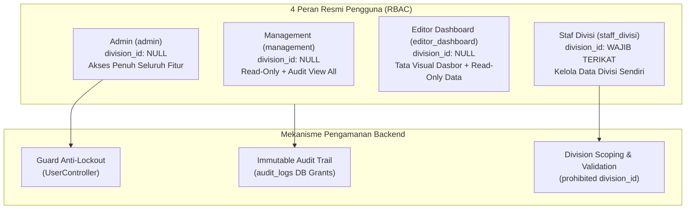
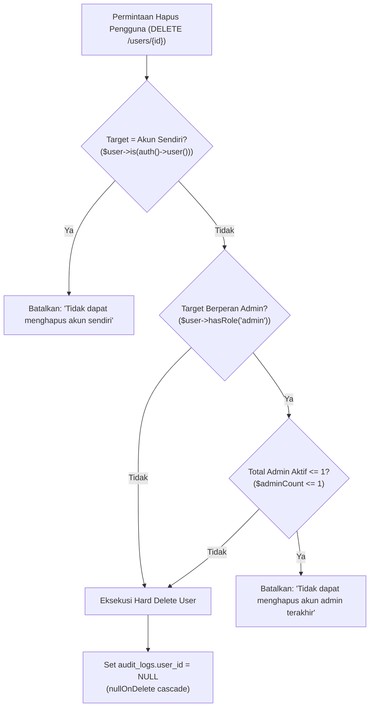
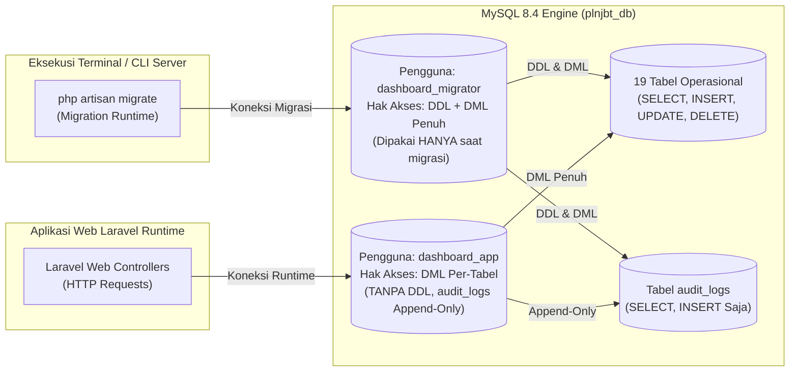

# 05 - Panduan Administrator, Kebijakan Hak Akses & Deployment Runbook

Dokumen ini memuat panduan komprehensif bagi Administrator Sistem, Database Administrator (DBA), serta Tim Infrastruktur Teknologi Informasi (IT) PLN Unit Induk Transmisi Jawa Bagian Tengah (UIT JBT) dalam mengelola hak akses pengguna, konfigurasi cakupan visualisasi, arsitektur keamanan basis data dua-pengguna (*two-user least privilege*), serta prosedur operasional pencadangan (*backup*), pemulihan (*restore*), dan mitigasi bencana (*disaster recovery*).

---

## 1. Pendahuluan & Gambaran Umum Pengelolaan Sistem

### 1.1 Tujuan Dokumen

Dokumen ini disusun untuk:
1. Memberikan pedoman baku dalam mengelola akun pengguna, penetapan peran (*roles*), dan pemetaan izin akses (*permissions*) berbasis arsitektur Role-Based Access Control (RBAC).
2. Menjelaskan mekanisme pengamanan *Guard Anti-Lockout* pada lapisan pengontrol (*controller*) dan antarmuka (*view*) yang mencegah sistem terkunci akibat hilangnya akun administrator.
3. Mendokumentasikan prosedur pengaturan cakupan unit visualisasi (`visible_units`) pada konfigurasi sistem aplikasi.
4. Menjabarkan arsitektur keamanan basis data MySQL dengan pemisahan peran akun migrator dan akun runtime aplikasi, penegakan sifat kekal (*append-only immutability*) pada tabel rekam jejak audit (*audit logs*), serta pengikatan jaringan tertutup (*loopback binding*).
5. Menyediakan panduan langkah-demi-langkah (*runbook*) pelaksanaan pencadangan berkala, pengujian pemulihan data pasca-kegagalan (*disaster recovery*), dan penanganan otomasi kontainer Docker di sistem operasi Windows.

### 1.2 Sasaran Pengguna (Target Audience)

- **Administrator Sistem Aplikasi:** Penanggung jawab operasional harian yang mengelola siklus hidup akun pengguna, peran, dan layout dasbor.
- **Database Administrator (DBA) & Tim Infrastruktur IT:** Pengelola mesin kontainer basis data MySQL 8.4, pemelihara skrip hardening hak akses, dan pelaksana prosedur pencadangan data.
- **DevOps / SysAdmin Server:** Pengelola host server Windows/Linux yang bertanggung jawab atas ketersediaan layanan Docker Desktop, jaringan loopback, dan integrasi penjadwalan otomasi eksternal (n8n).

---

## 2. Manajemen Pengguna & Kebijakan Keamanan RBAC

### 2.1 Empat Peran Resmi Sistem (Official System Roles)

Sistem menerapkan arsitektur RBAC granular dengan 4 peran resmi yang didefinisikan secara baku pada konstanta kelas `App\Models\Role`:

| Nama Peran | Nilai Slug (`roles.slug`) | Cakupan Divisi (`division_id`) | Deskripsi Wewenang & Hak Akses Operasional |
|---|---|---|---|
| **Administrator** | `admin` | `NULL` (Lintas Divisi) | Pengelola super (*superuser*) aplikasi. Memiliki seluruh izin akses (`PERMISSIONS`), mengelola seluruh akun pengguna, mengelola referensi divisi, mengatur konfigurasi layout dasbor untuk semua peran, serta mengelola dataset dan jejak audit penuh. |
| **Manajemen** | `management` | `NULL` (Lintas Divisi) | Pengguna eksekutif dan pimpinan. Bertindak sebagai pemantau utama capaian kinerja (*executive viewer*). Memiliki akses baca data (*read-only*), dapat melihat seluruh rekam jejak audit sistem termasuk aktivitas login dan mutasi pengguna (`audit.view_all`), serta mengunduh berkas laporan. Tidak diizinkan mengubah layout maupun memanipulasi data. |
| **Editor Dashboard** | `editor_dashboard` | `NULL` (Lintas Divisi) | Tim teknis IT yang bertugas menata arsitektur visual dasbor. Memiliki wewenang mengonfigurasi struktur komponen dan tata letak widget dasbor via antarmuka UI Builder (`dashboard.update`, `dashboard.create`, `dashboard.publish`). Memiliki akses *read-only mutlak* terhadap dataset (tanpa hak impor, ubah, atau hapus dataset). Memiliki hak melihat riwayat audit terbatas pada perubahan data (`audit.view`). |
| **Staf Divisi** | `staff_divisi` | **Wajib Terikat** (`NOT NULL`) | Operator penginput dan penyedia data divisi. Mengunggah berkas laporan kinerja bulanan dan mengelola dataset milik divisinya sendiri. Parameter `division_id` pada permintaan (*request*) mutasi data dikunci secara ketat dengan aturan `prohibited` untuk mencegah klaim data lintas divisi. Tidak memiliki akses ke manajemen pengguna maupun pengaturan tata letak visual. |



### 2.2 Matriks Izin Akses Granular (Permission Matrix)

Seluruh izin akses sistem bersumber dari satu katalog tunggal (*single source of truth*) pada konstanta `App\Models\Permission::PERMISSIONS`. Pemetaan izin terhadap masing-masing peran diinisialisasi melalui `Database\Seeders\RolePermissionSeeder`:

| Kode Izin Akses (`permissions.name`) | Deskripsi Fungsional | Admin | Management | Editor Dashboard | Staf Divisi |
|---|---|:---:|:---:|:---:|:---:|
| `user.view` | Melihat daftar akun pengguna | Ya | Tidak | Tidak | Tidak |
| `user.create` | Menambahkan akun pengguna baru | Ya | Tidak | Tidak | Tidak |
| `user.update` | Memperbarui data dan peran pengguna | Ya | Tidak | Tidak | Tidak |
| `user.delete` | Menghapus akun pengguna dari sistem | Ya | Tidak | Tidak | Tidak |
| `dataset.view` | Melihat daftar dataset dan tabel observasi | Ya | Ya | Ya | Ya |
| `dataset.import` | Mengunggah berkas Excel/CSV laporan baru | Ya | Tidak | Tidak | Ya |
| `dataset.update` | Memperbarui status/metadata dataset | Ya | Tidak | Tidak | Ya |
| `dataset.delete` | Menghapus berkas dan catatan dataset | Ya | Tidak | Tidak | Tidak |
| `dashboard.view` | Mengakses tampilan dasbor kinerja | Ya | Ya | Ya | Ya |
| `dashboard.create` | Membuat tata letak dasbor baru | Ya | Tidak | Ya | Tidak |
| `dashboard.update` | Mengubah susunan widget dan kolom dasbor | Ya | Tidak | Ya | Tidak |
| `dashboard.delete` | Menghapus konfigurasi tata letak dasbor | Ya | Tidak | Tidak | Tidak |
| `dashboard.publish` | Mempublikasikan tata letak dasbor ke peran lain | Ya | Tidak | Ya | Tidak |
| `audit.view` | Melihat riwayat perubahan data (dataset & metrik) | Ya | Ya | Ya | Tidak |
| `audit.view_all` | Melihat seluruh log sistem (termasuk autentikasi & user) | Ya | Ya | Tidak | Tidak |
| `report.export` | Mengunduh berkas laporan rekapitulasi data | Ya | Ya | Ya | Ya |

> [!NOTE]
> Pada antarmuka backend, izin akses diverifikasi secara deklaratif melalui Laravel Authorization Gates (`@can` pada template Blade dan `$this->authorize()` atau `Gate::authorize()` pada Controller). Konfigurasi tata letak widget pada `config/dashboard_layouts.php` bukan pengganti izin akses backend; setiap widget tetap diverifikasi melalui otorisasi server sebelum dirender.

### 2.3 Mekanisme Pertahanan Guard Anti-Lockout

Sistem mengimplementasikan pengamanan berlapis untuk mencegah kondisi terkunci (*system lockout*), di mana tidak ada lagi administrator aktif yang dapat mengelola sistem atau administrator secara tidak sengaja menghapus atau menurunkan hak aksesnya sendiri.

Mekanisme ini dikunci pada tiga titik kontrol:

#### 1. Titik Kontrol Penghapusan Pengguna (`UserController::destroy`)
Pada berkas `app/Http/Controllers/UserController.php`:
- **Pencegahan Penghapusan Diri Sendiri (*Anti Self-Deletion*):**
  Pemeriksaan `$user->is(auth()->user())` memastikan administrator yang sedang aktif dalam sesi tidak dapat menghapus akun miliknya sendiri. Permintaan ditolak dengan pesan kilas (*flash error*): *"Tidak dapat menghapus akun sendiri."*
- **Pencegahan Penghapusan Administrator Terakhir (*Anti-Delete Last Admin*):**
  Pemeriksaan `User::whereRelation('role', 'slug', Role::ADMIN)->count() <= 1` memastikan bahwa apabila akun yang akan dihapus berstatus `admin` dan jumlah administrator aktif di sistem hanya tersisa 1 (satu), penghapusan akan dibatalkan dengan pesan kilas: *"Tidak dapat menghapus akun admin terakhir."*

#### 2. Titik Kontrol Pembaruan Pengguna (`UserController::update`)
Pada berkas `app/Http/Controllers/UserController.php`:
- **Pencegahan Penurunan Peran Diri Sendiri (*Anti Self-Demotion*):**
  Jika seorang administrator mencoba mengubah perannya sendiri menjadi peran non-admin (`Role::MANAGEMENT`, `Role::EDITOR_DASHBOARD`, atau `Role::STAFF_DIVISI`), sistem mendeteksi kondisi `$isDemotingAdmin` dan menolak transaksi dengan pesan: *"Tidak dapat menurunkan role akun admin sendiri."*
- **Pencegahan Penurunan Peran Administrator Terakhir (*Anti-Demote Last Admin*):**
  Jika seorang administrator mencoba menurunkan peran akun administrator lain, namun penghitungan `adminCount` menunjukkan akun tersebut adalah admin terakhir yang tersisa, sistem membatalkan pembaruan dengan pesan: *"Tidak dapat mengubah role admin terakhir."*

#### 3. Titik Kontrol Antarmuka Blade (`resources/views/users/index.blade.php`)
Di tingkat antarmuka pengguna:
- Tombol aksi **Hapus** disembunyikan secara kondisional.
- Jika baris pengguna merupakan akun administrator yang sedang login, sistem menampilkan badge abu-abu: `[Akun Anda]`.
- Jika baris pengguna merupakan administrator tunggal yang tersisa di sistem (`$adminCount <= 1`), tombol hapus digantikan dengan badge peringatan: `[Admin Terakhir]`.
- Form konfirmasi penghapusan hanya akan di-render untuk akun lain yang bukan diri sendiri dan bukan administrator terakhir.



> [!IMPORTANT]
> Ketika sebuah akun pengguna dihapus, foreign key `user_id` pada tabel `audit_logs` diatur menjadi `NULL` melalui relasi database `nullOnDelete()`. Hal ini menjaga prinsip *append-only* agar catatan historis tindakan yang dilakukan pengguna tersebut di masa lalu tidak hilang atau terhapus secara berantai (*cascade deletion*).

---

## 3. Konfigurasi Lingkup Unit (`visible_units`) & Pembatasan Tampilan

### 3.1 Konsep & Provenance Keputusan Bisnis

Berdasarkan keputusan bisnis pengguna tanggal 12 Oktober 2026, dasbor KPI dikonfigurasi untuk hanya menampilkan unit induk organisasi PLN UIT JBT.

> [!NOTE]
> **Catatan Provenance Otorisasi:**
> Penetapan filter ini bersumber dari arahan langsung pengguna (*user decision*), bukan persetujuan formal tertulis (*formal sign-off*) dari mentor/evaluator eksternal. Konfigurasi ini diterapkan khusus pada lapisan pembacaan dasbor (*presentation read-path*). Seluruh data unit lain yang termuat dalam berkas Excel bulanan **tetap diimpor, divalidasi, dan disimpan utuh di basis data**, tanpa ada baris data yang dibuang atau ditolak saat proses impor berlangsung.

### 3.2 Implementasi Teknis (`config/kpi.php` & Trait `ScopesKpiUnits`)

Pengaturan cakupan unit dikelola terpusat pada berkas `config/kpi.php`:

```php
/*
 * Unit yang boleh TAMPIL di dashboard KPI.
 *
 * Scope default = TJBT SAJA.
 * Batas = TAMPILAN saja (read-path): unit lain tetap diimpor, disimpan,
 * dan TIDAK dihapus; hanya tidak ditampilkan di dashboard.
 *
 * null (atau array kosong) = TANPA pembatasan (jaring rollback).
 * Identitas unit bersifat case-sensitive: 'tjbt' bukan 'TJBT'.
 */
'visible_units' => ['TJBT'],
```

Trait `app/Http/Controllers/Concerns/ScopesKpiUnits.php` dikonsumsi oleh `DashboardController` dan controller pembaca visualisasi untuk memfilter data pada titik presentasi:
1. `visibleUnits(): ?array`: Mengambil daftar unit dari konfigurasi. Mengembalikan `null` jika konfigurasi bernilai `null` atau berupa array kosong.
2. `unitVisible(string $unit): bool`: Memeriksa apakah unit tertentu termasuk dalam daftar unit yang diizinkan (evaluasi peka huruf besar-kecil / *case-sensitive*).
3. `scopeUnits(array $units): array`: Menyaring daftar unit kerja dengan mempertahankan urutan indeks.
4. `countVisibleUnitRows(Builder $query): int`: Membatasi penghitungan jumlah baris metrik pada tabel legacy `performance_metrics` sesuai pola prefix unit (`TJBT | %`).
5. `scopeUnitMap(array $map): array`: Menyaring array asosiatif hasil agregasi (seperti nilai skor NKO per unit) menggunakan fungsi `array_intersect_key`.

Filter unit diterapkan **setelah** resolusi periode data dan **setelah** penetapan dataset aktif (*latest dataset resolution*), sehingga kontrak *latest dataset wins* tidak terganggu.

### 3.3 Prosedur Perubahan Lingkup Unit (SOP Konfigurasi)

Administrator dapat mengubah cakupan unit yang ditampilkan di dasbor dengan prosedur berikut:

#### Kasus A: Memperluas Akses Unit (Contoh: Menampilkan TJBT dan TJBB)
1. Buka berkas konfigurasi `config/kpi.php`.
2. Ubah parameter `visible_units`:
   ```php
   'visible_units' => ['TJBT', 'TJBB'],
   ```
3. Bersihkan cache konfigurasi aplikasi dari terminal server:
   ```bash
   docker compose exec -T app php artisan config:clear
   docker compose exec -T app php artisan config:cache
   ```

#### Kasus B: Membuka Seluruh Unit Tanpa Batasan (*Rollback ke Perilaku Awal*)
1. Buka berkas konfigurasi `config/kpi.php`.
2. Setel nilai `visible_units` menjadi `null`:
   ```php
   'visible_units' => null,
   ```
3. Bersihkan cache konfigurasi aplikasi:
   ```bash
   docker compose exec -T app php artisan config:clear
   docker compose exec -T app php artisan config:cache
   ```

> [!WARNING]
> Identitas unit kerja bersifat peka huruf kapital (*case-sensitive*), diselaraskan dengan aturan kolasi biner basis data (`utf8mb4_bin` pada `org_units.name`). Selalu gunakan huruf kapital penuh (contoh: `'TJBT'`, bukan `'tjbt'`).

---

## 4. Arsitektur Keamanan Basis Data Dua-Pengguna (Least Privilege)

### 4.1 Prinsip Keamanan & Masalah Default Docker MySQL

Secara default, container resmi MySQL Docker memberikan hak istimewa penuh (`GRANT ALL PRIVILEGES ON dashboard.*`) kepada akun operasional yang ditentukan pada variabel lingkungan `MYSQL_USER`.

Dalam skenario produksi, pemberian hak istimewa penuh kepada akun runtime aplikasi menimbulkan celah keamanan kritis:
1. Akun aplikasi memiliki wewenang Data Definition Language (DDL) seperti `CREATE`, `ALTER`, `DROP`, dan `TRUNCATE`.
2. Jika terjadi eksploitasi celah aplikasi atau injeksi SQL tingkat lanjut, penyerang dapat mengeksekusi perintah `TRUNCATE TABLE audit_logs` atau `DROP TABLE audit_logs`, sehingga seluruh jejak rekam audit hilang permanen.

Untuk menutup risiko tersebut, sistem menerapkan arsitektur pemisahan hak akses dua-pengguna (*two-user architecture*):



### 4.2 Spesifikasi Dua Pengguna Basis Data

#### 1. Pengguna Migrasi: `dashboard_migrator`
- **Tujuan:** Menjalankan pembaruan skema database melalui perintah migrasi framework (`php artisan migrate`).
- **Inisialisasi:** Dibuat otomatis saat inisialisasi volume kontainer pertama kali melalui skrip `docker/mysql/init/01-create-migrator.sh`.
- **Wewenang:** Memiliki hak penuh DDL (`CREATE`, `ALTER`, `DROP`, `REFERENCES`, `INDEX`) dan DML (`SELECT`, `INSERT`, `UPDATE`, `DELETE`) atas skema `dashboard`.*
- **Kredensial:** Disimpan pada variabel `.env`: `DB_MIGRATOR_USERNAME` dan `DB_MIGRATOR_PASSWORD`.

#### 2. Pengguna Runtime Aplikasi: `dashboard_app`
- **Tujuan:** Menangani operasi transaksi harian sistem saat aplikasi melayani permintaan pengguna (*runtime request*).
- **Wewenang:** Hanya memiliki hak DML per-tabel pada tabel operasional aplikasi. **Sama sekali tidak memiliki hak DDL**.
- **Kredensial:** Disimpan pada variabel `.env`: `DB_USERNAME` dan `DB_PASSWORD`.

### 4.3 Sifat Kekal Rekam Jejak Audit (*Append-Only Immutability*)

Pada tabel `audit_logs`, pengguna runtime `dashboard_app` secara sengaja hanya diberikan hak akses:
```sql
GRANT SELECT, INSERT ON `dashboard`.`audit_logs` TO 'dashboard_app'@'%';
```

Konsekuensi teknis penegakan hak akses ini:
1. **Penolakan Pembaruan (*Update Denied*):** Perintah `UPDATE audit_logs SET ...` ditolak langsung pada level engine MySQL dengan pesan kesalahan: `ERROR 1142 (42000): UPDATE command denied to user 'dashboard_app'@'...' for table 'audit_logs'`.
2. **Penolakan Penghapusan (*Delete Denied*):** Perintah `DELETE FROM audit_logs WHERE ...` ditolak langsung pada level engine MySQL dengan pesan kesalahan: `ERROR 1142 (42000): DELETE command denied to user 'dashboard_app'@'...' for table 'audit_logs'`.
3. **Pencegahan Pemusnahan Tabel (*No DDL*):** Tanpa hak akses `DROP` atau `ALTER`, perintah `TRUNCATE TABLE audit_logs` atau `DROP TABLE audit_logs` tidak dapat dieksekusi oleh akun runtime aplikasi.

### 4.4 Prosedur Hardening Hak Akses (`harden-audit-log.sql`)

MySQL memiliki karakteristik di mana hak akses tingkat basis data (`ON dashboard.*`) tidak dapat ditimpa dengan pembatasan hak tingkat tabel menggunakan `REVOKE` (menghasilkan *ERROR 1147*). Oleh karena itu, skrip `docker/mysql/harden-audit-log.sql` mencabut seluruh hak database-level terlebih dahulu, kemudian membangun ulang grant DML secara eksplisit per tabel.

> [!IMPORTANT]
> **Kapan Skrip Ini Wajib Dijalankan:**
> Karena MySQL menolak pemberian hak akses pada tabel yang belum tercipta (*ERROR 1146 Table doesn't exist*), skrip hardening grant ini **WAJIB dijalankan ulang setiap kali ada tabel baru yang ditambahkan melalui migration**, segera setelah `php artisan migrate` selesai dieksekusi.

#### Langkah Eksekusi Hardening Hak Akses:

1. Pastikan kontainer database `plnjbt_db` sedang berjalan.
2. Dari direktori utama proyek (*project root*), salin dan eksekusi skrip SQL hardening:
   ```bash
   # Salin skrip ke dalam kontainer database
   docker cp docker/mysql/harden-audit-log.sql plnjbt_db:/tmp/harden.sql

   # Eksekusi skrip menggunakan akun root database
   docker compose exec -T db bash -c "mysql -uroot -p\$DB_ROOT_PASSWORD < /tmp/harden.sql"
   ```
3. Verifikasi keberhasilan konfigurasi hak akses:
   ```bash
   docker compose exec -T db mysql -uroot -p"$DB_ROOT_PASSWORD" -e "SHOW GRANTS FOR 'dashboard_app'@'%';"
   ```
   Pastikan baris keluaran menunjukkan `GRANT SELECT, INSERT ON dashboard.audit_logs` tanpa ada izin `UPDATE` atau `DELETE`.

### 4.5 Pengamanan Port Jaringan & Pengguna Tambahan

1. **Pengikatan Loopback Host (`127.0.0.1:3306`):**
   Pada konfigurasi `docker-compose.yml`, pemetaan port database dikunci ke antarmuka loopback host:
   ```yaml
   ports:
     - "127.0.0.1:3306:3306"
   ```
   Pengikatan ini mencegah port database dapat dijangkau dari luar melalui antarmuka jaringan LAN kantor atau alamat IP publik server.
2. **Penghapusan Akun `root@%`:**
   Akun root MySQL hanya diizinkan tersambung secara lokal (`root@localhost`). Seluruh akun root publik (`root@%`) telah dihapus dari tabel otorisasi `mysql.user`.
3. **Pengguna Khusus Read-Only Host (`dashboard_ro`):**
   Akun `dashboard_ro@172.18.0.1` dialokasikan khusus untuk kebutuhan inspeksi perkakas diagnostik MCP dari sisi host server dengan wewenang `SELECT` penuh tanpa hak tulis.
4. **Pengguna Khusus Otomasi n8n (`n8n_ro`):**
   Akun `n8n_ro@172.18.0.0/255.255.0.0` dialokasikan untuk alur otomasi penjadwalan eksternal dengan pembatasan hak `GRANT SELECT` kolom-terbatas:
   - Tabel `datasets`: hanya kolom `id`, `original_name`, `status`, `created_at`, `updated_at`, dan `validation_report`.
   - Tabel `performance_metrics`: hanya kolom `dataset_id` dan `period`.
   Akun n8n tidak memiliki akses ke tabel `performance_observations`, `indicators`, maupun data kredensial pengguna pada tabel `users`.

---

## 5. SOP Backup, Restore & Pemulihan Bencana (Disaster Recovery Runbook)

### 5.1 Strategi Pencadangan Terjadwal (Backup Strategy)

Pengelolaan kelangsungan operasional sistem IBS / plnjbt-dashboard berpegang pada metrik pemulihan:
- **Recovery Point Objective (RPO):** Maksimal 24 jam (pencadangan harian otomatis) atau segera sebelum/sesudah pelaksanaan impor berkas bulanan resmi.
- **Recovery Time Objective (RTO):** Maksimal 30 menit untuk memulihkan layanan dasbor penuh pasca-insiden kegagalan perangkat keras server.

Arsip cadangan data wajib mencakup tiga komponen utama:
1. Cadangan basis data relasional (*logical SQL dump*).
2. Cadangan berkas fisik penyimpanan dataset (*storage repository*).
3. Cadangan berkas catatan analisis dan notula bisnis (*Obsidian knowledge vault*).

### 5.2 Prosedur Pencadangan Basis Data (Database Dump Runbook)

Pencadangan database dilakukan menggunakan utilitas `mysqldump` dengan flag `--single-transaction` dan `--quick` untuk menjamin konsistensi data transaksi tanpa mengunci (*table lock*) aplikasi yang sedang melayani pengguna.

#### Eksekusi Pencadangan via Linux / Bash:
```bash
# Tentukan direktori penyimpanan cadangan
BACKUP_DIR="./backups/db"
mkdir -p "$BACKUP_DIR"

# Buat berkas snapshot SQL terkompresi
TIMESTAMP=$(date +"%Y%m%d_%H%M%S")
BACKUP_FILE="$BACKUP_DIR/backup-dashboard-$TIMESTAMP.sql"

docker compose exec -T db mysqldump \
  -u root \
  -p"$DB_ROOT_PASSWORD" \
  --single-transaction \
  --quick \
  --default-character-set=utf8mb4 \
  dashboard > "$BACKUP_FILE"

# Kompresi berkas cadangan untuk menghemat media simpan
gzip -9 "$BACKUP_FILE"
echo "Pencadangan selesai: ${BACKUP_FILE}.gz"
```

#### Eksekusi Pencadangan via Windows PowerShell:
```powershell
$backupDir = ".\backups\db"
if (!(Test-Path $backupDir)) { New-Item -ItemType Directory -Path $backupDir -Force }

$timestamp = Get-Date -Format "yyyyMMdd_HHmmss"
$backupFile = "$backupDir\backup-dashboard-$timestamp.sql"

# Eksekusi mysqldump dari kontainer
docker compose exec -T db mysqldump `
  -u root `
  -p"$env:DB_ROOT_PASSWORD" `
  --single-transaction `
  --quick `
  --default-character-set=utf8mb4 `
  dashboard | Out-File -Encoding utf8 "$backupFile"

Write-Host "Pencadangan berhasil disimpan di: $backupFile"
```

### 5.3 Prosedur Pemulihan Basis Data (Database Restore Runbook)

Prosedur pemulihan dilakukan apabila terjadi kerusakan integritas data, kegagalan volume kontainer, atau kebutuhan pengembalian (*rollback*) lingkungan staging.

> [!CAUTION]
> Tindakan restore akan menimpa seluruh data yang ada saat ini. Pastikan untuk membuat satu snapshot darurat (*pre-restore dump*) sebelum menjalankan instruksi pemulihan.

#### Langkah Pemulihan Data:

1. **Hentikan Sementara Akses Aplikasi:**
   Hentikan kontainer aplikasi web agar tidak ada transaksi baru yang masuk saat proses pemulihan berjalan:
   ```bash
   docker compose stop app
   ```

2. **Eksekusi Pemulihan Skema & Data:**
   Jalankan utilitas import MySQL ke dalam kontainer basis data:
   ```bash
   # Jika berkas dalam format terkompresi (.gz), ekstrak terlebih dahulu:
   gunzip -k backup-dashboard-YYYYMMDD_HHMMSS.sql.gz

   # Import berkas SQL ke database dashboard
   docker compose exec -T db mysql -u root -p"$DB_ROOT_PASSWORD" dashboard < backup-dashboard-YYYYMMDD_HHMMSS.sql
   ```

3. **Eksekusi Wajib Skrip Hardening Hak Akses:**
   Setelah proses restore selesai, jalankan ulang skrip hardening hak akses untuk memastikan akun `dashboard_app` tetap mematuhi aturan append-only:
   ```bash
   docker cp docker/mysql/harden-audit-log.sql plnjbt_db:/tmp/harden.sql
   docker compose exec -T db bash -c "mysql -u root -p\$DB_ROOT_PASSWORD < /tmp/harden.sql"
   ```

4. **Nyalakan Kembali Kontainer Aplikasi:**
   ```bash
   docker compose start app
   docker compose exec -T app php artisan config:clear
   docker compose exec -T app php artisan cache:clear
   ```

5. **Verifikasi Integritas Data Pasca-Pemulihan:**
   Jalankan query verifikasi untuk memastikan baris data metrik, indikator, dan dataset terbaru kembali sesuai kondisi cadangan:
   ```bash
   docker compose exec -T db mysql -u root -p"$DB_ROOT_PASSWORD" dashboard -e "
     SELECT status, COUNT(*) as total FROM datasets GROUP BY status;
     SELECT COUNT(*) as total_indicators FROM indicators;
     SELECT COUNT(*) as total_observations FROM performance_observations;
     SELECT COUNT(*) as total_audit_logs FROM audit_logs;
   "
   ```

### 5.4 Pencadangan Berkas Fisik & Dokumen Proyek

Selain basis data MySQL, dua direktori fisik berikut wajib dicadangkan secara berkala:

1. **Direktori Penyimpanan Dataset (`storage/app/`):**
   Memuat berkas fisik Excel `.xlsx` asli yang diunggah oleh pengguna (`storage/app/datasets/`). Berkas ini merupakan data primer jika sewaktu-waktu dibutuhkan komputasi ulang (*re-parsing*):
   ```bash
   tar -czvf backup-storage-$(date +%Y%m%d).tar.gz storage/app/
   ```

2. **Direktori Basis Pengetahuan & Bukti Proyek (`Obsidian/`):**
   Memuat seluruh dokumentasi bisnis, kamus data aset, notula pertemuan mentor, dan riwayat analisis kebutuhan:
   ```bash
   tar -czvf backup-obsidian-$(date +%Y%m%d).tar.gz Obsidian/
   ```

3. **Berkas Konfigurasi Lingkungan (`.env`):**
   Salin berkas `.env` ke media penyimpanan aman yang terpisah dari server fisik aplikasi (contoh: *Key Management Service* atau brankas kata sandi korporat). Jangan pernah melakukan commit berkas `.env` ke repositori Git publik.

### 5.5 Penanganan Otomasi Kontainer & Docker Desktop di Lingkungan Windows

Pada host server berbasis Windows Server atau Windows Desktop, pemeliharaan ketersediaan layanan pasca-reboot berkala memerlukan pengaturan berikut:

#### 1. Konfigurasi Startup Docker Desktop
1. Buka aplikasi **Docker Desktop**.
2. Klik ikon gerigi **Settings** di pojok kanan atas.
3. Pada tab **General**, pastikan opsi berikut tercentang:
   - `Start Docker Desktop when you sign in`
   - `Open Docker Desktop dashboard at Windows startup` (opsional)
4. Klik **Apply & restart**.

#### 2. Konfigurasi Kebijakan Restart Kontainer (`restart: unless-stopped`)
Pada berkas `docker-compose.yml`, pastikan setiap layanan memiliki konfigurasi:
```yaml
restart: unless-stopped
```
Dengan kebijakan ini, Docker Engine akan otomatis menyalakan ulang kontainer `plnjbt_app`, `plnjbt_db`, dan service terkait segera setelah daemon Docker aktif pasca-reboot sistem operasi.

#### 3. Penjadwalan Pemulihan Layanan via Windows Task Scheduler
Untuk memastikan layanan tetap menyala meskipun tidak ada pengguna yang login secara interaktif di sesi Windows (misalnya setelah server me-restart otomatis akibat Windows Update):
1. Buka utilitas **Task Scheduler** Windows (`taskschd.msc`).
2. Buat tugas baru (*Create Task*) dengan nama: `IBS_Dashboard_AutoStart`.
3. Pada tab **General**:
   - Pilih opsi `Run whether user is logged on or not`.
   - Centang opsi `Run with highest privileges`.
4. Pada tab **Triggers**:
   - Tambahkan trigger baru: `At startup`.
   - Berikan jeda waktu (*delay*) selama 1 atau 2 menit untuk memberi waktu daemon Docker Engine menginisialisasi socket.
5. Pada tab **Actions**:
   - Action: `Start a program`.
   - Program/script: `powershell.exe`.
   - Add arguments:
     `-NoProfile -ExecutionPolicy Bypass -Command "cd C:\Users\ASUS\Documents\dashboard; docker compose up -d"`
6. Simpan tugas dengan memasukkan kredensial administrator host.

#### 4. Script Pemantauan Kesehatan Layanan (Healthcheck Script)
Simpan skrip PowerShell sederhana berikut untuk memantau status kontainer secara periodik:

```powershell
# healthcheck-containers.ps1
$containers = @("plnjbt_app", "plnjbt_db")
$allHealthy = $true

foreach ($container in $containers) {
    $status = docker inspect --format="{{.State.Running}}" $container 2>$null
    if ($status -ne "true") {
        Write-Warning "Kontainer $container tidak dalam kondisi berjalan!"
        $allHealthy = $false
    }
}

if (!$allHealthy) {
    Write-Host "Mencoba memulihkan kontainer yang mati..."
    docker compose up -d
} else {
    Write-Host "Seluruh layanan kontainer berjalan normal."
}
```

---

## 6. Ringkasan Prosedur Tindakan Cepat (Cheatsheet Administrator)

| Kebutuhan Operasional | Perintah Eksekusi CLI | Lokasi Berkas Rujukan |
|---|---|---|
| Menambah akun user baru | Via antarmuka web: `/users/create` | `app/Http/Controllers/UserController.php` |
| Memperluas cakupan unit dasbor | Edit `visible_units` pada `config/kpi.php` lalu jalankan `php artisan config:clear` | `config/kpi.php` |
| Menjalankan migrasi skema database | `docker compose exec -T app php artisan migrate` (memakai `dashboard_migrator`) | `docker/mysql/init/01-create-migrator.sh` |
| Mengunci kembali hak akses database | `docker cp docker/mysql/harden-audit-log.sql plnjbt_db:/tmp/harden.sql`<br/>`docker compose exec -T db bash -c "mysql -uroot -p\$DB_ROOT_PASSWORD < /tmp/harden.sql"` | `docker/mysql/harden-audit-log.sql` |
| Verifikasi sifat append-only audit | `docker compose exec -T db mysql -uroot -p"$DB_ROOT_PASSWORD" -e "SHOW GRANTS FOR 'dashboard_app'@'%';"` | `docker/mysql/harden-audit-log.sql` |
| Backup darurat database | `docker compose exec -T db mysqldump -u root -p"$DB_ROOT_PASSWORD" --single-transaction --quick dashboard > backup.sql` | Section 5.2 dokumen ini |
| Restore data pasca-insiden | `docker compose exec -T db mysql -u root -p"$DB_ROOT_PASSWORD" dashboard < backup.sql` dilanjutkan skrip hardening | Section 5.3 dokumen ini |
| Restart kontainer aplikasi | `docker compose restart app` | `docker-compose.yml` |
