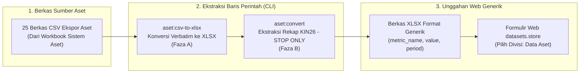
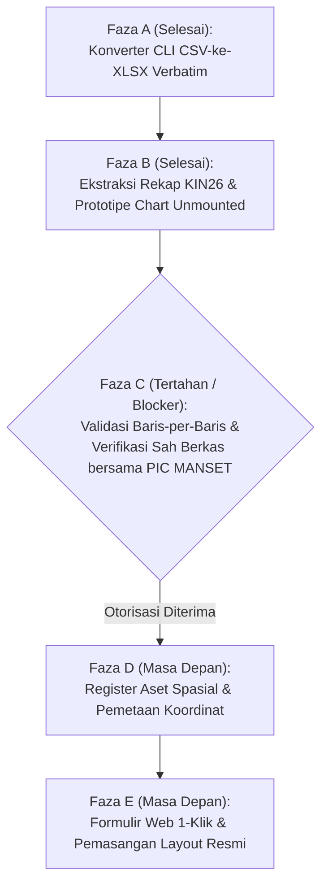

# 06 - Batasan Sistem, Dependensi Legacy & Rencana Lanjutan (System Roadmap)

Dokumen ini memuat dokumentasi resmi mengenai batasan teknis sistem (*system limitations*), status domain data Aset, alasan retensi dependensi modul legacy sebagai jaring pengaman (*instant rollback net*), daftar kontak pemangku kepentingan transisi (*stakeholder registry*), serta panduan rekomendasi alih kelola bagi tim IT PLN Unit Induk Transmisi Jawa Bagian Tengah (UIT JBT).

---

## 1. Pendahuluan & Status Kesiapan Sistem

Sistem IBS / plnjbt-dashboard telah menyelesaikan seluruh fase stabilisasi operasional untuk domain utama **Kinerja Organisasi (Key Performance Indicator / KPI)** di bawah bidang Perencanaan Pengusahaan. Sistem beroperasi stabil dengan arsitektur pembacaan model terstruktur (*structured read model*) secara default, pemrosesan transaksi *dual-write*, penegakan hak akses peran (RBAC), serta pencatatan audit log append-only.

Kendati demikian, untuk menjamin kesinambungan pemeliharaan oleh tim pengembang internal PLN UIT JBT pasca-program magang, batasan-batasan desain yang disengaja (*intentional design decisions*), batasan domain sekunder (Data Aset), dan kriteria pembersihan modul legacy perlu didokumentasikan secara rinci agar tidak terjadi salah tafsir atau perubahan kode yang membahayakan stabilitas sistem produksi.

---

## 2. Status, Batasan & Panduan Domain Aset

### 2.1 Status Pipeline Ingestion Data Aset

Domain Data Aset merupakan modul pendukung yang dirancang untuk mengelola rekapitulasi data aset transmisi (stok material, trafo, jalur transmisi, dan menara). Berbeda dengan modul KPI yang telah terintegrasi penuh melalui antarmuka web 1-klik, status alur pemrosesan data aset saat ini masih berupa rantai perintah antarmuka baris perintah (*Command Line Interface / CLI*):



Rincian implementasi perintah CLI:
1. **Perintah `aset:csv-to-xlsx` (`App\Console\Commands\ConvertAssetCsv`):**
   - Bertugas mengonversi direktori berisi 25 berkas CSV hasil ekspor workbook aset menjadi lembar kerja Excel `.xlsx` satu-per-satu tanpa mengubah isi sel (*verbatim conversion*).
   - Membutuhkan alokasi memori PHP besar (`memory_limit = 2G`) karena menangani berkas register peralatan masif (seperti `DATA TOWER` yang mencapai lebih dari 20.000 baris data).
2. **Perintah `aset:convert` (`App\Console\Commands\ConvertAssetReport`):**
   - Membaca berkas rekapitulasi `KIN26 - STOP ONLY (.xlsx)` dan mengekstraksi pasangan data metrik ke dalam format template generik tiga kolom (`metric_name`, `value`, `period`).
   - Hasil konversi diunggah oleh operator ke antarmuka web melalui form `datasets.create` dengan memilih divisi "Data Aset" secara manual.

### 2.2 Status Visualisasi & Komponen Widget Aset

Pada katalog tata letak dasbor (`config/dashboard_layouts.php`), sistem menyediakan definisi widget:
```php
'aset-upt-chart' => [
    'default_cols' => 3,
    'label' => 'Stok Aset per UPT',
    'view' => 'widgets.aset-upt-chart',
    'permission' => 'dashboard.view'
],
```

**Status Pemasangan: PROTOTIPE DEMO (Commit `46d0112`)**
Per 11 November 2026, gembok internal `FORBIDDEN_WIDGETS` telah dibuka dan widget `aset-upt-chart` dipasang secara sah pada tata letak default staf divisi Managemen Aset (`staff_divisi:managemen-aset`) dengan lebar 3 kolom (`default_cols => 3`) tepat di bawah kartu `dataset-status`.

Karakteristik implementasi prototipe demo:
1. **Pill Badge Transparansi Visual:** Header widget memuat lencana visual penanda: *"Prototipe Demo (Rekapitulasi UPT)"* agar audiens dan pemangku kepentingan memahami bahwa data bersumber dari prototipe ekstraksi.
2. **Cakupan Series UPT:** Widget menampilkan agregasi hingga 25 unit/UPT dari rekapitulasi ULTG yang difokuskan pada tiga kelompok peralatan utama: Tower, Transmisi, dan Trafo.
3. **Isolasi Scoping Divisi:** Sesuai arsitektur sistem, data aset terikat ke divisi Managemen Aset. Staf dari divisi lain (seperti Perencanaan Pengusahaan) tidak melihat widget ini pada tata letak default mereka.
4. **Status Otorisasi:** Pembukaan widget ini dilakukan berdasarkan instruksi eksplisit developer untuk kebutuhan prototipe demonstrasi antarmuka, dan **BUKAN** merupakan sign-off formal dari mentor, Pak Gama, atau PIC Managemen Aset.

### 2.3 Status Tata Kelola & Batasan Domain Aset Menuju Produksi Penuh

Seluruh tim pengembang dan administrator penerima sistem wajib memperhatikan batasan tata kelola berikut:

> [!IMPORTANT]
> **CATATAN TATA KELOLA 1: VERIFIKASI PIC & BERITA ACARA TETAP MENJADI PRASYARAT PRODUKSI**
> Status widget pada layout staf MANSET saat ini murni prototipe demo. Penerapan penuh sebagai sistem pencatatan resmi (*system of record*) tetap memerlukan penunjukan resmi PIC Managemen Aset (MANSET), penyusunan Berita Acara serah-terima definisi data, serta verifikasi 38 atribut data formal (Faza C).

> [!WARNING]
> **LARANGAN KERAS 2: DILARANG MENGANGGAP FORMULA SUMIFS CACAT SEBAGAI BUG SISTEM**
> Pada berkas CSV ekspor individual, ditemukan sejumlah baris yang menghasilkan observasi bernilai nol atau kosong. Kondisi ini terjadi karena formula `SUMIFS` pada lembar kerja Excel asli merujuk ke berkas/sheet eksternal lain yang terputus saat diekspor menjadi CSV tunggal. **Hal ini BUKAN kesalahan (*bug*) pada konverter aplikasi**. Dilarang memanipulasi angka sintetis atau mengubah parser aplikasi untuk "memaksa" nilai nol tersebut terisi tanpa persetujuan tertulis dari PIC MANSET.

> [!IMPORTANT]
> **LARANGAN KERAS 3: PENANGGUHAN FAZA D DAN FAZA E**
> Pengerjaan Faza D (peta koordinat geografis dan register inventaris peralatan menara/trafo skala besar) serta Faza E (penyediaan antarmuka web mandiri untuk impor 1-klik divisi Aset) **DITANGGUHKAN SECARA RESMI**. Implementasi baru boleh dilanjutkan apabila ada nota dinas atau penugasan formal baru dari pihak manajemen PLN UIT JBT.

### 2.4 Peta Rencana Pengembangan Domain Aset (Asset Roadmap)



---

## 3. Dependensi Legacy yang Dipertahankan sebagai Jaring Pengaman (Rollback Net)

### 3.1 Rasional Keberadaan Tabel `performance_metrics` dan Reader Legacy

Pada pembaruan sistem Fase 4.3, sumber data pembacaan dasbor telah dialihkan secara default ke model terstruktur (`performance_observations`, `indicators`, dan `org_units`). Namun, tabel `performance_metrics` dan reader kode jalur legacy (R1 sampai R7, R9, dan R10) **secara sengaja tidak dihapus dari basis data dan kode aplikasi**.

Alasan teknis dan bisnis keputusan ini meliputi:

#### 1. Jaring Pengaman Instan Tanpa Downtime (*Instant Rollback Net*)
Apabila ditemukan anomali kalkulasi, ketidaksesuaian indeks sheet baru, atau kegagalan tak terduga pada model terstruktur di lingkungan produksi, Administrator Sistem dapat langsung mengembalikan seluruh dasbor ke jalur pembacaan legacy tanpa perlu melakukan rollback commit kode (*code rollback*) atau migrasi mundur basis data (*database down migration*).
Pengembalian dapat dilakukan hanya dalam hitungan detik:
```bash
# Buka berkas .env dan ubah flag baca:
KPI_READ_MODEL=legacy

# Bersihkan cache dari kontainer aplikasi:
docker compose exec -T app php artisan config:clear
```
Seluruh dasbor akan seketika kembali membaca data flat dari tabel `performance_metrics`.

#### 2. Keterikatan Fitur-Fitur Non-KPI yang Masih Aktif
Tabel `performance_metrics` masih digunakan secara aktif oleh beberapa modul operasional:
- **Unggahan Dataset Generik Non-KPI:** Berkas data divisi di luar Perencanaan Pengusahaan (seperti Data Aset dan Pengadaan) menggunakan skema tiga kolom generik yang dipetakan langsung ke tabel `performance_metrics`.
- **Halaman Detail Dataset (`datasets.show`):** Menampilkan cuplikan tabel data mentah metrik yang tersimpan.
- **Fitur Ekspor Dataset (`datasets.export`):** Menyediakan fitur unduh ulang berkas dataset dalam format CSV/Excel berbasis baris metrik.
- **Modul Sunting Nilai Metrik Manual:** Fitur koreksi angka darurat bagi administrator.
- **Penelusuran Jejak Audit (*Audit Log Filter*):** Log historis audit merujuk pada `auditable_type = App\Models\PerformanceMetric`.

#### 3. Kontrak Bisnis Hybrid pada Endpoint R1 (`/api/performance-data`)
Berdasarkan Keputusan Bisnis 1 bersama Pak Gama (tanggal 25 Oktober 2026), endpoint grafik kinerja R1 sengaja dikonfigurasi dalam mode **Hybrid**:
- Data seri tren (`series`) dan rata-rata skor (`kpi.average_nko`) dihitung dari tabel terstruktur `performance_observations`.
- Namun, jumlah metrik (`kpi.metric_count`) dan dataset aktif (`kpi.ready_datasets`) tetap menghitung baris pada tabel `performance_metrics`.
Hal ini menjaga ekspektasi manajemen yang terbiasa melihat total 41 baris metrik flat pada lembar kerja unit TJBT, dibandingkan 30 observasi indikator murni hasil normalisasi.

### 3.2 Prasyarat Pembersihan Final (Deprecation Roadmap)

Pembersihan dan penghapusan permanen tabel `performance_metrics` serta kode reader legacy hanya boleh dieksekusi apabila seluruh kriteria berikut telah terpenuhi secara utuh:

1. **Masa Uji Staging Jangka Panjang:**
   Sistem telah beroperasi dalam mode `KPI_READ_MODEL=structured` secara kontinu selama minimal **tiga (3) siklus pelaporan bulanan berturut-turut** di lingkungan produksi tanpa sekalipun memerlukan pembalikan (*fallback*) ke mode legacy.
2. **Standardisasi Skema Multi-Divisi:**
   Telah dirancang dan diimplementasikan skema terstruktur universal untuk divisi-divisi lain di luar Perencanaan Pengusahaan, sehingga fungsi impor dataset generik tidak lagi bergantung pada tabel `performance_metrics`.
3. **Refaktorisasi Modul Dependen:**
   Halaman `datasets.show`, fungsi ekspor berkas, dan penyuntingan manual telah dimigrasikan untuk membaca entitas `performance_observations`.
4. **Berita Acara Kesepakatan Tim IT PLN:**
   Adanya Berita Acara Serah Terima (BAST) dan persetujuan tertulis antara Tim Pengembang dan Tim IT PLN UIT JBT yang menyatakan bahwa jaring pengaman legacy sudah dapat dimusnahkan (*fully deprecated*).

### 3.3 Inventarisasi & Rasional 39 Skipped Tests dalam Rangkaian Pengujian

Saat menjalankan perintah pengujian otomatis `php artisan test`, sistem secara konsisten melaporkan **39 skipped tests**. Keberadaan 39 pengujian yang dilewati ini adalah keputusan desain yang disengaja (*intentional test design*), bukan kegagalan sistem (*test failures*).

Berikut adalah rincian inventarisasi 39 skipped tests:

| No | Berkas Test (`tests/Feature/`) | Jumlah Skipped | Modul / Fitur yang Diuji | Status & Alasan Skip |
|---|---|:---:|---|---|
| 1 | `PerformanceUploadTest.php` | 12 | Upload performa legacy (`PerformanceUploadController`) | Sengaja dipensiunkan: rute tidak terdaftar di `routes/web.php` pasca-penerapan arsitektur dataset terstruktur dual-write. |
| 2 | `ReportIndexTest.php` | 9 | Halaman indeks laporan (`ReportController::index`) | Sengaja dinonaktifkan: blok rute `/reports` di-comment pada `routes/web.php:98-110`. |
| 3 | `ReportAuditExportTest.php` | 7 | Ekspor audit jejak laporan (`ReportController::exportAudit`) | Sengaja dinonaktifkan: rute ekspor laporan di-comment pada `routes/web.php`. |
| 4 | `ReportValidationExportTest.php` | 5 | Ekspor laporan validasi (`ReportController::exportValidation`) | Sengaja dinonaktifkan: rute ekspor laporan di-comment pada `routes/web.php`. |
| 5 | `ReportDatasetSummaryExportTest.php` | 4 | Ekspor ringkasan dataset (`ReportController::exportDatasetSummary`) | Sengaja dinonaktifkan: rute ekspor laporan di-comment pada `routes/web.php`. |
| 6 | `KpiReaderComparisonCharacterizationTest.php` | 2 | Paritas karakterisasi R6 vs R7 pada live dataset | Paritas dinamis: otomatis di-skip (`markTestSkipped`) pada lingkungan pengujian SQLite in-memory saat basis data pengujian belum memiliki fixture dataset terstruktur aktif. |
| **Total** | | **39** | | |

#### Rasional Preservasi (Mengapa Tidak Dihapus Sekarang):
1. **Preservasi Dokumentasi Kontrak Fungsional:** Tiga puluh tujuh (37) test modul laporan dan upload legacy mendokumentasikan spesifikasi perilaku kode yang telah teruji. Mempertahankan test dalam status *skipped* mencegah false alarms pada CI runner tanpa menghilangkan basis pengetahuan implementasi jika fitur laporan sewaktu-waktu diaktifkan kembali.
2. **Kesiapan Reaktivasi Fitur:** Jika manajemen atau tim IT PLN UIT JBT ingin mengaktifkan kembali modul laporan `/reports/*`, tim pengembang tidak perlu menulis ulang suite pengujian; cukup membuka blok komentar di `routes/web.php` dan mencabut pemanggilan `markTestSkipped()`.
3. **Isolasi Lingkungan CI:** Dua (2) test pada `KpiReaderComparisonCharacterizationTest.php` dirancang untuk memvalidasi angka paritas pada live dataset MySQL dev riil (Dataset #49), sehingga wajar dilewati pada pipeline CI yang menggunakan SQLite in-memory bersih.

#### Mitigasi & Prosedur jika Ingin Dihapus Permanen oleh Tim IT PLN:
Apabila pasca-handover tim pengembang PLN memutuskan untuk membersihkan seluruh kode tidak aktif agar test suite 100% tanpa skip:
1. Pastikan telah ada persetujuan internal bahwa fitur `/reports/*` dan `PerformanceUploadController` tidak akan dihidupkan kembali.
2. Hapus 2 controller tidak aktif: `app/Http/Controllers/ReportController.php` dan `app/Http/Controllers/PerformanceUploadController.php`.
3. Hapus 5 berkas pengujian modul legacy: `PerformanceUploadTest.php`, `ReportIndexTest.php`, `ReportAuditExportTest.php`, `ReportValidationExportTest.php`, dan `ReportDatasetSummaryExportTest.php` (menghapus 37 test skipped).
4. Untuk 2 test di `KpiReaderComparisonCharacterizationTest.php`, tambahkan seeder observasi sintetis pada method `setUp()` agar test selalu lulus di SQLite, atau pertahankan skip bersyaratnya.

---

## 4. Jalur Komunikasi, Kontak PIC & Rekomendasi Alih Kelola IT PLN

### 4.1 Pemangku Kepentingan Utama (Stakeholder Registry)

Berikut adalah daftar pejabat dan pihak yang bertanggung jawab atas pengelolaan fungsional dan teknis aplikasi:

| Peran Pemangku Kepentingan | Nama Pejabat / Kontak | Bidang / Unit | Tanggung Jawab Utama |
|---|---|---|---|
| **PIC Evaluasi Kinerja & Data Bisnis** | **Pak Gama** | Bidang Perencanaan Pengusahaan | Penanggung jawab sah berkas laporan kinerja bulanan, validator formula KPI, dan pengambil keputusan bisnis terkait polaritas serta indikator kinerja PLN UIT JBT. |
| **Mentor Pembimbing Magang** | **Pak Syahril** | Bidang STEI / Transmisi | Pembimbing teknis program, koordinator kebutuhan lintas divisi, dan penanggung jawab evaluasi teknis implementasi sistem. |
| **PIC Managemen Aset (MANSET)** | **PIC Bidang Terkait** | Bidang Managemen Aset | Penanggung jawab data aset (kontak masa depan untuk verifikasi Faza C sebelum integrasi modul Aset). |
| **Administrator & Tim DevOps IT** | **Tim IT PLN UIT JBT** | Sub-bidang Sistem Informasi & Otomasi | Penanggung jawab ketersediaan server host, konfigurasi jaringan, backup rutin database, dan integrasi workflow otomasi n8n. |

### 4.2 Prosedur Eskalasi Insiden Operasional

Jika terjadi kendala pada saat operasional harian, ikuti alur eskalasi berjenjang berikut:

```mermaid
flowchart TD
    Incident["Insiden Terjadi Saat Operasional"] --> Classify{"Klasifikasi Jenis Masalah"}

    Classify -- "Format Berkas Excel Salah /<br/>Nilai Formula Tidak Sesuai" --> EscL1["Tingkat 1: Hubungi PIC Kinerja (Pak Gama)<br/>Solusi: Koreksi Berkas Excel Bulanan"]
    Classify -- "Aplikasi Web Mati /<br/>Database Error / Port Terputus" --> EscL2["Tingkat 2: Hubungi Tim IT PLN UIT JBT<br/>Solusi: Cek Kontainer Docker & Restore"]
    Classify -- "Perubahan Struktur Organisasi /<br/>Penambahan Indikator Baru" --> EscL3["Tingkat 3: Rapat Koordinasi Bersama Mentor (Pak Syahril)<br/>Solusi: Penyesuaian Kamus Data & Migration"]
```



### 4.3 Panduan Rekomendasi Alih Kelola bagi Tim Pengembang IT PLN

Bagi staf pengembang IT PLN UIT JBT yang menerima pemeliharaan sistem ini ke depan, berikut adalah rekomendasi praktik terbaik (*best practices*) yang wajib dijalankan:

#### 1. Pengawasan Performa Basis Data MySQL 8.4
- Pantau ukuran berkas data InnoDB pada volume `db_data`. Seiring bertambahnya data historis bulanan, pertimbangkan untuk meningkatkan alokasi `innodb_buffer_pool_size` pada berkas konfigurasi MySQL kontainer (rekomendasi: 50-70% dari kapasitas RAM server yang dialokasikan untuk database).
- Periksa log kueri lambat (*slow query log*) secara periodik. Pastikan seluruh kueri pembacaan dasbor memanfaatkan indeks komposit yang telah disediakan (`idx_dataset_unit_indicator` pada tabel `performance_observations`).

#### 2. Kebijakan Rotasi Kredensial Berkala (Tahunan)
- Lakukan rotasi kata sandi untuk akun basis data minimal satu kali setiap tahun:
  1. Kata sandi root database (`MYSQL_ROOT_PASSWORD`).
  2. Kata sandi pengguna aplikasi (`dashboard_app`).
  3. Kata sandi pengguna migrator (`dashboard_migrator`).
  4. Kata sandi akun otomasi (`n8n_ro`).
- Perbarui nilai pada berkas `.env`, jalankan `php artisan config:clear`, dan pastikan koneksi berjalan normal.

#### 3. Standar Pemeriksaan Kualitas Kode (CI Pipeline Gates)
Sebelum melakukan pembaruan kode ke repositori cabang `main`, staf pengembang PLN diwajibkan menjalankan rantai verifikasi kualitas berikut:
```powershell
# 1. Format kode sesuai standar PSR-12 / Laravel Pint
vendor/bin/pint --dirty

# 2. Eksekusi seluruh rangkaian pengujian otomatis
php artisan test

# 3. Verifikasi ketiadaan whitespace liar
git diff --check

# 4. Verifikasi konsistensi hak akses database append-only
bash docker/mysql/assert-audit-grants.sh
```

#### 4. Pemeliharaan Rutin Ruang Penyimpanan (Disk Space Hygiene)
- Bersihkan antrean pekerjaan yang gagal (*failed jobs*) secara periodik dengan perintah:
  ```bash
  docker compose exec -T app php artisan queue:flush
  ```
- Lakukan pengarsipan berkas cadangan (*backup archives*) yang telah berusia lebih dari 90 hari ke media penyimpanan sekunder atau tape backup korporat.
- Jangan menyimpan berkas sementara atau dump database di dalam direktori repositori Git.

---

## 5. Ringkasan Status Modul Sistem (Handover Readiness Matrix)

| Modul / Domain | Status Kesiapan | Mode Operasional | Tindakan yang Diperlukan ke Depan |
|---|---|---|---|
| **KPI Perencanaan Pengusahaan** | **Siap Produksi (Production Ready)** | Terstruktur (`KPI_READ_MODEL=structured`) | Pengunggahan rutin bulanan oleh PIC (Pak Gama). |
| **Arsitektur Dual-Write & Compensator** | **Siap Produksi (Production Ready)** | Otomatis di Backend | Pengawasan status dataset (`READY` vs `FAILED`). |
| **RBAC & Guard Anti-Lockout** | **Siap Produksi (Production Ready)** | Aktif di Controller & Blade | Pengelolaan akun pengguna oleh Administrator Sistem. |
| **Keamanan DB Dua-User & Append-Only** | **Siap Produksi (Production Ready)** | Ditegakkan di Engine MySQL | Menjalankan ulang `harden-audit-log.sql` pasca-migrasi baru. |
| **Domain Data Aset (MANSET)** | **Prototipe CLI (Unmounted)** | Terbatas pada CLI (`aset:convert`) | Menunggu konfirmasi resmi dan validasi data Faza C oleh PIC MANSET. |
| **Jalur Rollback Legacy (`performance_metrics`)** | **Dipertahankan (Rollback Net)** | Pasif (Siap dialihkan via `.env`) | Dipertahankan selama masa evaluasi minimal 3 siklus bulanan. |
| **Otomasi Terjadwal n8n** | **Terintegrasi (Read-Only)** | Terbatas pada 6 kolom metadata | Pemeliharaan alur notifikasi oleh Tim IT PLN. |
